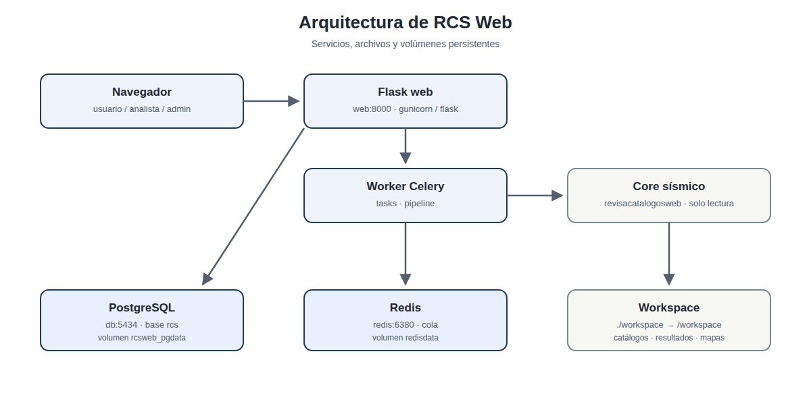
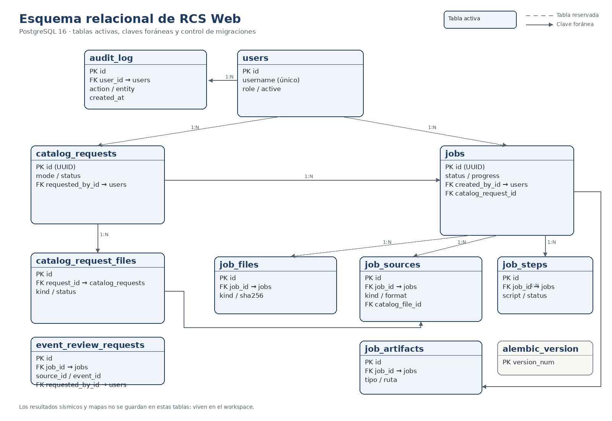
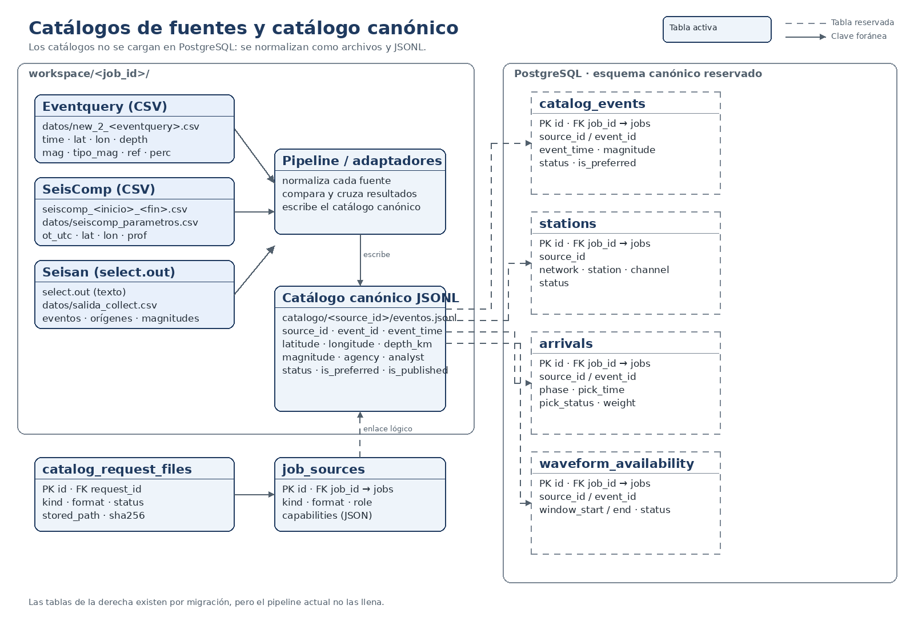

# Manual técnico

Documentación de instalación, operación, almacenamiento y mantenimiento de
RCS Web.

**Versión:** 0.7.3 · **Actualizado:** noviembre de 2026

## Arquitectura

RCS Web es una aplicación Flask con tareas asíncronas en Celery. La interfaz
web y el worker comparten el mismo código y el mismo espacio de trabajo. El
core sísmico está incorporado en `core/` y sus datos grandes en `core_data/`.



| Componente | Función |
|---|---|
| **Flask web** | Interfaz, autenticación, permisos, tablas, paneles y descargas |
| **Celery worker** | Ejecuta el pipeline del core incorporado |
| **PostgreSQL** | Usuarios, trabajos, archivos, pasos, artefactos, solicitudes y auditoría |
| **Redis** | Cola de Celery |
| **Core sísmico** | Scripts incorporados en `core/` |
| **Workspace** | Archivos de entrada y salida de cada trabajo |

## Puesta en marcha

### Requisitos

- Docker y Docker Compose.
- El código del core en `core/`.
- Los datos grandes del core en `core_data/`, instalados con
  `scripts/instalar_core_data.sh` o copiados desde una instalación existente.
- Los datos sísmicos externos y Cartopy en el host.
- El archivo `.env` configurado.

### Variables principales

| Variable | Uso | Valor por defecto |
|---|---|---|
| `DATABASE_URL` | Conexión SQLAlchemy | `postgresql+psycopg://rcs:rcs@db:5432/rcs` |
| `WORKSPACE_ROOT` | Carpeta de trabajos dentro del contenedor | `/workspace` |
| `RCS_CORE_PATH` | Código del core dentro del contenedor | `/app/core` |
| `RCS_CORE_DATA` | Datos grandes del core | `/app/core_data` |
| `DATOS_PATH` | Datos externos dentro del contenedor | `/data` |
| `CARTOPY_DATA_DIR` | Datos de Cartopy | `/data/cartopy` |
| `MAPS_MODE` | `auto`, `online` u `offline` | `auto` |
| `ADMIN_USERNAME` | Administrador inicial | `admin` |
| `ADMIN_PASSWORD` | Clave inicial del administrador | `admin` |

Cambie `ADMIN_PASSWORD` antes de la primera puesta en marcha. `seed-admin`
solo crea el usuario si no existe; no cambia una clave existente.

### Arranque

```bash
docker compose up -d --build
docker compose ps
```

Las migraciones y el administrador inicial se ejecutan al iniciar el servicio
`web`:

```bash
docker compose exec web flask --app app db upgrade
docker compose exec web flask --app app seed-admin
```

La aplicación queda en `http://127.0.0.1:8000`.

## Servicios, puertos y volúmenes

| Servicio | Puerto host | Descripción |
|---|---|---|
| `web` | `8000` | Flask / Gunicorn |
| `db` | `5434` | PostgreSQL 16 |
| `redis` | `6380` | Redis |

| Volumen | Tipo | Contenido |
|---|---|---|
| `pgdata` | Volumen Docker | Datos de PostgreSQL |
| `redisdata` | Volumen Docker | Persistencia de Redis |
| `./workspace` | Bind mount | Archivos de los trabajos |

El servicio `web` monta además `./app`, `./tasks` y `./migrations`, y el core y
los datos en solo lectura.

## Almacenamiento

### Base de datos

- Contenedor: **`rcsweb-db`**.
- Imagen: **`postgres:16`**.
- Base de datos: **`rcs`**.
- Usuario: **`rcs`**.
- Puerto del host: **`127.0.0.1:5434`**.
- Volumen Docker: **`rcsweb_pgdata`**.
- Ruta física en el host:
  **`/var/lib/docker/volumes/rcsweb_pgdata/_data`**.
- Ruta dentro del contenedor:
  **`/var/lib/postgresql/data`**.

El volumen es un directorio de PostgreSQL, no un archivo `.db`. No se debe
editar ni copiar con la base encendida. Para inspeccionarlo:

```bash
sudo docker volume inspect rcsweb_pgdata
sudo ls -la /var/lib/docker/volumes/rcsweb_pgdata/_data
sudo du -sh /var/lib/docker/volumes/rcsweb_pgdata/_data
df -h /var/lib/docker
```

### Esquema relacional

RCS Web usa una base PostgreSQL 16 para el estado de la aplicación. La base
guarda usuarios, solicitudes, trabajos, archivos, pasos, artefactos, fuentes y
auditoría; **no guarda los catálogos sísmicos, los resultados ni los mapas**.
Esos archivos viven en el workspace de cada trabajo.



Los diagramas se regeneran con:

```bash
.venv/bin/python scripts/generar_esquema_bd.py
```

#### Grupos de tablas

| Grupo | Tablas | Función |
|---|---|---|
| Seguridad | `users`, `audit_log` | Cuentas, roles y registro de acciones |
| Solicitudes | `catalog_requests`, `catalog_request_files` | Pedidos de catálogos y archivos asociados |
| Trabajos | `jobs`, `job_files`, `job_sources`, `job_steps`, `job_artifacts` | Ejecución, insumos, fuentes, pasos y descargas |
| Catálogo canónico reservado | `catalog_events`, `stations`, `arrivals`, `waveform_availability` | Esquema futuro para eventos, estaciones, arribos y ondas |
| Migraciones | `alembic_version` | Revisión aplicada por Alembic |

La relación de propiedad es `jobs.created_by_id → users.id`. Los trabajos
creados por solicitud usan el usuario que hizo la solicitud. Los trabajos sin
creador (datos antiguos o de demostración) solo los ven administradores y
supervisores.

#### Relaciones y borrado

| Tabla hija / campo | Tabla padre | Cardinalidad | Al borrar |
|---|---|---|---|
| `catalog_requests.requested_by_id` | `users` | N:1 | `SET NULL` |
| `jobs.created_by_id` | `users` | N:1 | `SET NULL` |
| `audit_log.user_id` | `users` | N:1 | `SET NULL` |
| `catalog_request_files.request_id` | `catalog_requests` | N:1 | `CASCADE` |
| `jobs.catalog_request_id` | `catalog_requests` | N:1 | `SET NULL` |
| `job_sources.catalog_file_id` | `catalog_request_files` | N:1 | `SET NULL` |
| `job_files.job_id` | `jobs` | N:1 | `CASCADE` |
| `job_sources.job_id` | `jobs` | N:1 | `CASCADE` |
| `job_steps.job_id` | `jobs` | N:1 | `CASCADE` |
| `job_artifacts.job_id` | `jobs` | N:1 | `CASCADE` |
| `catalog_events.job_id` | `jobs` | N:1 | `CASCADE` |
| `stations.job_id` | `jobs` | N:1 | `CASCADE` |
| `arrivals.job_id` | `jobs` | N:1 | `CASCADE` |
| `waveform_availability.job_id` | `jobs` | N:1 | `CASCADE` |

Al eliminar un trabajo con `catalog_request_id`, `eliminar_trabajo()` marca
`catalog_requests.job_deleted_at` antes de borrar el trabajo. La solicitud se
conserva como historial. Si se crea un trabajo nuevo desde la misma solicitud,
`acquisition` limpia esa marca.

En la interfaz, `_estado_inicial()` traduce el estado de descarga y
`_estado_final()` decide entre «Trabajo vigente», «Trabajo eliminado»,
«Preparando trabajo» y «Sin trabajo». El listado y el detalle muestran ambos
estados por separado; la fecha de `job_deleted_at` aparece en la columna
**Eliminado** y en el detalle.

`catalog_events`, `stations`, `arrivals` y `waveform_availability` no tienen
claves foráneas hacia `job_sources`: `source_id` y `event_id` son claves
lógicas del catálogo canónico.

#### Diccionario de tablas

##### `users`

| Columna | Tipo | Nulo | Clave / índice | Descripción |
|---|---|:---:|---|---|
| `id` | Integer | No | PK | Identificador |
| `username` | String(80) | No | UNIQUE | Nombre de acceso |
| `password_hash` | String(255) | No | — | Hash de la contraseña |
| `role` | String(32) | No | — | `admin`, `supervisor`, `analista` o `consulta` |
| `analyst_code` | String(80) | Sí | — | Código corto de analista |
| `analyst_aliases` | Text | Sí | — | Alias separados por coma o punto y coma |
| `active` | Boolean | No | — | Cuenta habilitada |
| `created_at` | DateTime(tz) | No | — | Fecha de creación |

##### `audit_log`

| Columna | Tipo | Nulo | Clave / índice | Descripción |
|---|---|:---:|---|---|
| `id` | Integer | No | PK | Identificador |
| `user_id` | Integer | Sí | FK → `users.id` | Usuario que ejecutó la acción |
| `action` | String(64) | No | IDX | Acción registrada |
| `entity` | String(80) | Sí | — | Entidad afectada |
| `meta` | JSON | Sí | — | Datos adicionales |
| `created_at` | DateTime(tz) | No | IDX | Fecha de la acción |

##### `catalog_requests`

| Columna | Tipo | Nulo | Clave / índice | Descripción |
|---|---|:---:|---|---|
| `id` | String(36) | No | PK | UUID de la solicitud |
| `mode` | String(16) | No | — | `upload` o `ssh` |
| `period_start` | DateTime(tz) | Sí | — | Inicio del período solicitado |
| `period_end` | DateTime(tz) | Sí | — | Fin del período solicitado |
| `status` | String(20) | No | IDX | Estado de la solicitud |
| `progress` | Integer | No | — | Porcentaje de avance |
| `current_step` | String(80) | Sí | — | Paso actual |
| `primary_source` | String(32) | Sí | — | Fuente principal |
| `station_radius_km` | Integer | Sí | — | Radio de estaciones |
| `requested_by_id` | Integer | Sí | FK → `users.id` | Usuario solicitante |
| `server` | String(255) | Sí | — | Servidor SSH |
| `remote_user` | String(80) | Sí | — | Usuario remoto |
| `created_at` | DateTime(tz) | No | IDX | Fecha de creación |
| `started_at` | DateTime(tz) | Sí | — | Inicio de ejecución |
| `finished_at` | DateTime(tz) | Sí | — | Fin de ejecución |
| `job_deleted_at` | DateTime(tz) | Sí | — | Fecha en que se eliminó el trabajo asociado |
| `error` | Text | Sí | — | Error, si corresponde |

##### `catalog_request_files`

| Columna | Tipo | Nulo | Clave / índice | Descripción |
|---|---|:---:|---|---|
| `id` | Integer | No | PK | Identificador |
| `request_id` | String(36) | No | FK → `catalog_requests.id`, IDX | Solicitud asociada |
| `kind` | String(32) | No | — | Tipo de catálogo |
| `format` | String(32) | No | — | Formato efectivo |
| `display_name` | String(80) | Sí | — | Nombre visible del catálogo |
| `progress` | Integer | No | — | Avance de la extracción, 0–100 |
| `status` | String(20) | No | — | Estado del archivo |
| `stored_path` | String(255) | Sí | — | Ruta de almacenamiento |
| `original_name` | String(255) | Sí | — | Nombre original |
| `size` | Integer | No | — | Tamaño en bytes |
| `sha256` | String(64) | Sí | IDX | Huella del archivo |
| `message` | Text | Sí | — | Mensaje de error o validación |

##### `jobs`

| Columna | Tipo | Nulo | Clave / índice | Descripción |
|---|---|:---:|---|---|
| `id` | String(36) | No | PK | UUID del trabajo |
| `period_start` | DateTime(tz) | Sí | — | Inicio del período |
| `period_end` | DateTime(tz) | Sí | — | Fin del período |
| `status` | String(20) | No | IDX | Estado del trabajo |
| `progress` | Integer | No | — | Porcentaje de avance |
| `current_step` | String(80) | Sí | — | Paso actual |
| `station_radius_km` | Integer | Sí | — | Radio de estaciones |
| `created_by_id` | Integer | Sí | FK → `users.id` | Creador |
| `created_at` | DateTime(tz) | No | IDX | Fecha de creación |
| `started_at` | DateTime(tz) | Sí | — | Inicio de ejecución |
| `finished_at` | DateTime(tz) | Sí | — | Fin de ejecución |
| `error` | Text | Sí | — | Error, si corresponde |
| `origin` | String(16) | No | — | `upload` o `ssh` |
| `catalog_request_id` | String(36) | Sí | FK → `catalog_requests.id` | Solicitud de origen |

##### `job_files`

| Columna | Tipo | Nulo | Clave / índice | Descripción |
|---|---|:---:|---|---|
| `id` | Integer | No | PK | Identificador |
| `job_id` | String(36) | No | FK → `jobs.id`, IDX | Trabajo asociado |
| `kind` | String(32) | No | — | `seisan`, `eventquery` o `seiscomp` |
| `original_name` | String(255) | No | — | Nombre original |
| `stored_name` | String(255) | No | — | Nombre almacenado |
| `size` | Integer | No | — | Tamaño en bytes |
| `sha256` | String(64) | Sí | IDX | Huella del archivo |
| `uploaded_at` | DateTime(tz) | No | — | Fecha de carga |

##### `job_sources`

| Columna | Tipo | Nulo | Clave / índice | Descripción |
|---|---|:---:|---|---|
| `id` | Integer | No | PK | Identificador |
| `job_id` | String(36) | No | FK → `jobs.id`, IDX | Trabajo asociado |
| `kind` | String(64) | No | UNIQUE (`job_id`, `kind`) | Código de la fuente |
| `alias` | String(80) | No | — | Nombre visible |
| `format` | String(32) | No | — | Formato efectivo |
| `role` | String(24) | No | — | `local_principal` o `local_secundaria` |
| `priority` | Integer | No | — | Prioridad de la fuente |
| `status` | String(20) | No | — | `ok` o `error` |
| `message` | Text | Sí | — | Detalle del error |
| `capabilities` | JSON | Sí | — | Capacidades declaradas |
| `catalog_file_id` | Integer | Sí | FK → `catalog_request_files.id` | Archivo de origen |

##### `job_steps`

| Columna | Tipo | Nulo | Clave / índice | Descripción |
|---|---|:---:|---|---|
| `id` | Integer | No | PK | Identificador |
| `job_id` | String(36) | No | FK → `jobs.id`, IDX | Trabajo asociado |
| `orden` | Integer | No | — | Orden de ejecución |
| `script` | String(120) | No | — | Script ejecutado |
| `status` | String(20) | No | — | Estado del paso |
| `exit_code` | Integer | Sí | — | Código de salida |
| `started_at` | DateTime(tz) | Sí | — | Inicio |
| `finished_at` | DateTime(tz) | Sí | — | Fin |
| `log_path` | String(255) | Sí | — | Ruta del registro |

##### `job_artifacts`

| Columna | Tipo | Nulo | Clave / índice | Descripción |
|---|---|:---:|---|---|
| `id` | Integer | No | PK | Identificador |
| `job_id` | String(36) | No | FK → `jobs.id`, IDX | Trabajo asociado |
| `tipo` | String(48) | No | — | Tipo de artefacto |
| `ruta` | String(255) | No | — | Ruta relativa al workspace |
| `mime` | String(80) | Sí | — | Tipo MIME |
| `size` | Integer | No | — | Tamaño en bytes |

##### `alembic_version`

| Columna | Tipo | Nulo | Clave / índice | Descripción |
|---|---|:---:|---|---|
| `version_num` | String(32) | No | PK | Revisión de Alembic aplicada |

#### Tablas canónicas reservadas

Las cuatro tablas siguientes existen por migración, pero el pipeline actual no
las llena. Se documentan para que el esquema quede completo y para futuras
extensiones de la app.

##### `catalog_events`

| Columna | Tipo | Nulo | Clave / índice | Descripción |
|---|---|:---:|---|---|
| `id` | Integer | No | PK | Identificador |
| `job_id` | String(36) | No | FK → `jobs.id`, IDX | Trabajo asociado |
| `source_id` | String(64) | No | IDX | Fuente lógica |
| `event_id` | String(128) | No | IDX | Identificador en la fuente |
| `event_time` | DateTime(tz) | Sí | — | Fecha y hora |
| `latitude` | Float | Sí | — | Latitud |
| `longitude` | Float | Sí | — | Longitud |
| `depth_km` | Float | Sí | — | Profundidad |
| `magnitude` | Float | Sí | — | Magnitud |
| `magnitude_type` | String(16) | No | — | Tipo de magnitud |
| `agency` | String(80) | No | — | Agencia |
| `analyst` | String(80) | No | — | Analista |
| `status` | String(32) | No | — | `published` o `reported` |
| `is_preferred` | Boolean | No | — | Solución preferida |
| `is_published` | Boolean | No | — | Publicado en Eventquery |
| `raw` | JSON | Sí | — | Registro original |

Restricción: `UNIQUE (job_id, source_id, event_id)`.

##### `stations`

| Columna | Tipo | Nulo | Clave / índice | Descripción |
|---|---|:---:|---|---|
| `id` | Integer | No | PK | Identificador |
| `job_id` | String(36) | No | FK → `jobs.id`, IDX | Trabajo asociado |
| `source_id` | String(64) | No | IDX | Fuente lógica |
| `network` | String(16) | No | — | Red |
| `station` | String(16) | No | — | Estación |
| `location` | String(16) | No | — | Localización |
| `channel` | String(16) | No | — | Canal |
| `latitude` | Float | Sí | — | Latitud |
| `longitude` | Float | Sí | — | Longitud |
| `elevation_m` | Float | Sí | — | Elevación |
| `depth_m` | Float | Sí | — | Profundidad |
| `start_time` | DateTime(tz) | Sí | — | Inicio de operación |
| `end_time` | DateTime(tz) | Sí | — | Fin de operación |
| `sample_rate` | Float | Sí | — | Frecuencia de muestreo |
| `response` | Text | Sí | — | Respuesta instrumental |
| `status` | String(32) | No | — | Estado |

##### `arrivals`

| Columna | Tipo | Nulo | Clave / índice | Descripción |
|---|---|:---:|---|---|
| `id` | Integer | No | PK | Identificador |
| `job_id` | String(36) | No | FK → `jobs.id`, IDX | Trabajo asociado |
| `source_id` | String(64) | No | IDX | Fuente lógica |
| `event_id` | String(128) | No | IDX | Evento lógico |
| `origin_id` | String(128) | No | — | Origen lógico |
| `network` | String(16) | No | — | Red |
| `station` | String(16) | No | — | Estación |
| `location` | String(16) | No | — | Localización |
| `channel` | String(16) | No | — | Canal |
| `phase` | String(16) | No | — | Fase |
| `pick_time` | DateTime(tz) | Sí | — | Instante del pick |
| `pick_status` | String(16) | No | — | `manual` o `automatic` |
| `is_used_in_solution` | Boolean | Sí | — | Usado en la solución |
| `weight` | Float | Sí | — | Peso |
| `polarity` | String(16) | No | — | Polaridad |
| `residual` | Float | Sí | — | Residuo |
| `distance_km` | Float | Sí | — | Distancia |
| `azimuth` | Float | Sí | — | Azimut |
| `snr` | Float | Sí | — | Relación señal/ruido |
| `qc` | String(32) | No | — | Control de calidad |
| `picker_probability` | Float | Sí | — | Probabilidad del picker |

##### `waveform_availability`

| Columna | Tipo | Nulo | Clave / índice | Descripción |
|---|---|:---:|---|---|
| `id` | Integer | No | PK | Identificador |
| `job_id` | String(36) | No | FK → `jobs.id`, IDX | Trabajo asociado |
| `source_id` | String(64) | No | IDX | Fuente lógica |
| `event_id` | String(128) | No | IDX | Evento lógico |
| `network` | String(16) | No | — | Red |
| `station` | String(16) | No | — | Estación |
| `location` | String(16) | No | — | Localización |
| `channel` | String(16) | No | — | Canal |
| `window_start` | DateTime(tz) | Sí | — | Inicio de ventana |
| `window_end` | DateTime(tz) | Sí | — | Fin de ventana |
| `status` | String(20) | No | — | Estado de disponibilidad |
| `source` | String(32) | No | — | Origen del chequeo |
| `coverage_from` | DateTime(tz) | Sí | — | Inicio de cobertura |
| `coverage_to` | DateTime(tz) | Sí | — | Fin de cobertura |
| `checked_at` | DateTime(tz) | Sí | — | Fecha del chequeo |
| `error` | Text | Sí | — | Error |

#### Estados usados

| Campo | Valores |
|---|---|
| `jobs.status` | `draft`, `queued`, `running`, `cancelling`, `cancelled`, `done`, `failed` |
| `catalog_requests.status` | `draft`, `queued`, `running`, `partial`, `done`, `failed`, `cancelled` |
| `catalog_request_files.status` | `pending`, `downloading`, `ok`, `error` |
| `job_sources.status` | `ok`, `error` |
| `job_steps.status` | `pending`, `running`, `skipped`, `done`, `failed` |
| `waveform_availability.status` | `not_checked` y estados de la extensión |

#### Índices y restricciones

| Tabla | Índice o restricción |
|---|---|
| `users` | `UNIQUE (username)` |
| `catalog_requests` | `IDX (status)`, `IDX (created_at)` |
| `catalog_request_files` | `IDX (request_id)`, `IDX (sha256)` |
| `jobs` | `IDX (status)`, `IDX (created_at)` |
| `job_files` | `IDX (job_id)`, `IDX (sha256)` |
| `job_sources` | `UNIQUE (job_id, kind)`, `IDX (job_id)` |
| `job_steps` | `IDX (job_id)` |
| `job_artifacts` | `IDX (job_id)` |
| `audit_log` | `IDX (action)`, `IDX (created_at)` |
| `catalog_events` | `UNIQUE (job_id, source_id, event_id)`, `IDX (job_id, source_id, event_id)` |
| `stations` | `IDX (job_id, source_id)` |
| `arrivals` | `IDX (job_id, source_id, event_id)` |
| `waveform_availability` | `IDX (job_id, source_id, event_id)` |

#### Migraciones

| Revisión | Cambio |
|---|---|
| `cb10aab37264` | Esquema base |
| `87eb5ccba2fe` | Catálogo canónico y extensiones |
| `5b45ba75d014` | Progreso de solicitudes |
| `7457da261ab1` | Fuente principal en solicitudes |
| `ccd1bba64919` | Radio de estaciones |
| `9f1c2a7b4d10` | Alias visibles sin mecanismo de origen |
| `b7e4c1a9d2f3` | Nombre visible de archivos de catálogo |
| `c2a8f5d7e901` | Progreso por archivo de solicitud |
| `d4f7a1c9e502` | Marca de trabajo eliminado en la solicitud |
| `e5a1c2b3d604` | Código corto y alias de analista en usuarios |

Para consultar o aplicar migraciones:

```bash
flask --app app db current
flask --app app db history
flask --app app db upgrade
```

En Docker:

```bash
make migrate    # aplica migraciones pendientes
make up         # aplica migraciones y levanta web, worker, db y redis
make restart    # reinicia web y worker
```

`make up` ejecuta `make migrate` antes de levantar los servicios. El comando
`flask db upgrade` del contenedor `web` corre al arrancar, pero el recargador de
Flask no lo repite cuando cambia el código. Si se actualiza el repositorio sin
reiniciar, hay que ejecutar `make migrate` y luego reiniciar `web` y `worker`.
El `worker` depende de que `web` esté saludable para no procesar solicitudes con
un esquema incompleto.

Las pruebas usan SQLite en memoria (`TestConfig`), por lo que no reproducen
todas las diferencias de PostgreSQL. La base de producción es PostgreSQL 16.

### Catálogos de fuentes y catálogo canónico

#### No hay tablas relacionales por fuente

Las fuentes **Eventquery**, **SeisComp** y **Seisan** no se cargan en
PostgreSQL. El pipeline las lee desde archivos, las normaliza y escribe un
catálogo canónico JSONL en el workspace. La base solo conserva los metadatos de
qué fuente y qué archivo se usaron.



#### Manifiesto de fuentes

El contrato objetivo es que los programas que preparan los catálogos entreguen
un manifiesto junto con los datos canónicos. La app no debe conocer de antemano
los nombres ni la cantidad de fuentes.

Ejemplo:

```json
{
  "schema_version": "1.0",
  "sources": [
    {
      "id": "referencia",
      "label": "Eventquery",
      "description": "Catálogo público de referencia",
      "role": "reference",
      "visible_in_observaciones": false,
      "catalog_file": "catalogo/referencia/eventos.jsonl",
      "capabilities": ["eventos", "origenes", "magnitudes"]
    },
    {
      "id": "local_a",
      "label": "SeisComp",
      "role": "local",
      "visible_in_observaciones": true,
      "priority": 1,
      "catalog_file": "catalogo/local_a/eventos.jsonl",
      "capabilities": ["eventos", "origenes", "magnitudes", "arribos"]
    }
  ]
}
```

Campos principales:

| Campo | Uso |
|---|---|
| `id` | Identificador técnico y estable; se usa en rutas y comparaciones |
| `label` | Nombre visible para el usuario |
| `description` | Texto opcional para identificar el catálogo |
| `role` | `reference` para la fuente de comparación; `local` para las fuentes locales |
| `visible_in_observaciones` | Si aparece en los filtros de Resultados |
| `priority` | Prioridad cuando hay varias fuentes locales |
| `catalog_file` | Ruta del catálogo canónico JSONL |
| `capabilities` | Datos que aporta la fuente |

La app debe usar `role=local` para los filtros de Resultados y excluir
`role=reference`. No debe comparar el texto `eventquery`, `seisan` o
`seiscomp`.

**Estado de esta versión:** la app carga el manifiesto desde
`app/domain/catalogs/sources.json`, o desde la ruta indicada por
`CATALOG_SOURCES_MANIFEST`. Los formularios de solicitud y carga, los filtros de
Paneles, las pestañas de catálogos, Resultados, Detalle y la adquisición usan
las fuentes del manifiesto. Los adaptadores del pipeline siguen indexados por
`format`: una fuente nueva con un formato existente funciona sin tocar la app;
un formato nuevo requiere su adaptador o preparación externa. Las claves
internas del registro son `referencia`, `local_select` y `local_export`, con
alias para los nombres históricos.

El manifiesto se valida al arrancar. Debe tener exactamente una fuente con
`role=reference`, al menos una fuente local, IDs únicos y seguros, formatos,
validadores y handlers conocidos. Para comprobarlo manualmente:

```bash
flask --app app sources validate
```

El comando muestra cada fuente y termina con error si el manifiesto no es
válido.

#### Nombres visibles de catálogos

El nombre visible es un metadato de presentación; no es la identidad técnica:

- `source_id`: identifica la fuente en rutas, archivos y comparaciones.
- `label` o alias: se muestra en filtros, tablas, paneles y encabezados de PNG.
- `description`: texto opcional para distinguir dos catálogos del mismo tipo.

Ubicaciones previstas:

| Nivel | Campo |
|---|---|
| Solicitud o carga completa | `CatalogRequest.title` |
| Archivo descargado | `CatalogRequestFile.display_name` |
| Fuente dentro del trabajo | `JobSource.alias` (ya existe) |
| Manifiesto canónico | `label` y `description` |

Reglas:

- El nombre visible es opcional.
- Si falta, se usa el `label` del manifiesto o el `source_id`.
- Puede repetirse, con una advertencia de desambiguación.
- No se usa para construir rutas ni para decidir roles.
- Cambiar el nombre visible no invalida catálogos ni resultados.

#### Archivos y normalización

El manifiesto por defecto declara las fuentes de la tabla. Un manifiesto
distinto puede declarar otras fuentes o cambiar sus nombres visibles.

| Fuente | Entrada y normalización | Capacidades |
|---|---|---|
| Eventquery | `eventquery_<inicio>_<fin>.csv`; el adaptador usa `datos/new_2_<eventquery>.csv` como catálogo publicado de referencia | `eventos`, `origenes`, `magnitudes`, `percibidos` |
| SeisComp | `seiscomp_<inicio>_<fin>.csv` → `datos/seiscomp_parametros.csv` | `eventos`, `origenes`, `magnitudes`, `arribos`, `inventario`, `disponibilidad_ondas` |
| Seisan | `select.out` → `datos/salida_collect.csv` | `eventos`, `origenes`, `magnitudes`, `excluidos` |

Columnas mínimas que valida la app:

| Fuente | Estructura mínima |
|---|---|
| Eventquery | `time`, `lat`, `lon`, `depth`, `mag`, `tipo_mag`, `ref`, `perc` |
| SeisComp | `ot_utc`, `latitud`, `longitud`, `profundidad_km`, `magnitud`, `tipo_magnitud`, `operador` |
| Seisan | `select.out`: líneas con año, mes, día, hora, minuto y segundo |

Los adaptadores normalizan a `Fecha_Hora`, `Latitud`, `Longitud`, `Prof.`,
`Mag.`, `Tipo_mag.` y `Analista`. El catálogo canónico agrega `source_id`,
`event_id`, `agency`, `status`, `is_preferred`, `is_published` y `raw`.

`job_sources` registra las fuentes locales del trabajo: `kind`, `format`,
`role`, `priority`, `capabilities` y el `catalog_file_id` cuando el archivo vino
de una solicitud. `job_files` registra los archivos subidos y
`catalog_request_files` los archivos descargados por SSH.

#### Catálogo canónico JSONL

Ruta:

```text
workspace/<job_id>/catalogo/<source_id>/eventos.jsonl
```

Cada línea es un objeto `EventoCanonico`:

| Campo | Tipo | Descripción |
|---|---|---|
| `source_id` | texto | Fuente que aportó el evento |
| `event_id` | texto | Identificador dentro de la fuente |
| `event_time` | texto / fecha | Fecha y hora del evento |
| `latitude` | decimal | Latitud |
| `longitude` | decimal | Longitud |
| `depth_km` | decimal | Profundidad |
| `magnitude` | decimal | Magnitud |
| `magnitude_type` | texto | Tipo de magnitud |
| `agency` | texto | Agencia o fuente |
| `analyst` | texto | Analista |
| `status` | texto | `published` o `reported` |
| `is_preferred` | booleano | Solución preferida |
| `is_published` | booleano | Publicado en Eventquery |
| `raw` | JSON | Fila original normalizada |

Los contratos de estación, arribo y disponibilidad de onda están definidos en
`app/domain/catalogs/schema.py`:

| Contrato | Campos principales |
|---|---|
| `EstacionCanonica` | `source_id`, `network`, `station`, `location`, `channel`, coordenadas, elevación, profundidad, vigencia, `sample_rate`, `response`, `status` |
| `ArriboCanonico` | `source_id`, `event_id`, `origin_id`, estación/canal, `phase`, `pick_time`, `pick_status`, `weight`, `residual`, `distance_km`, `azimuth`, `snr`, `qc`, `picker_probability` |
| `DisponibilidadOnda` | `source_id`, `event_id`, estación/canal, ventana, `status`, `source`, cobertura, `checked_at`, `error` |

#### Contrato canónico de resultados

Para que una fuente nueva no obligue a cambiar Resultados, los programas de
preparación deben emitir archivos con nombres y columnas genéricas:

```text
resultados/
  no_publicados_<source_id>.csv
  no_actualizados_<source_id>.csv
  repetidos_<source_id>_<informe>.csv
```

Las columnas de comparación deben usar nombres genéricos:

- `fecha_referencia`, `lat_referencia`, `lon_referencia`,
  `prof_referencia`, `mag_referencia`;
- `fecha_local`, `lat_local`, `lon_local`, `prof_local`, `mag_local`;
- `analista`;
- atribución de analistas por fuente, sin nombres de fuente en el código.

Los mapas de catálogo incluyen en el encabezado el resultado de
`_texto_filtros_catalogo(q, filtros)`: búsqueda de texto y cada filtro de
columna con su título y valor. La app leerá el rol de referencia y las fuentes
locales desde el manifiesto, no
desde el nombre de las columnas.

**Estado de esta versión:** los resultados actuales todavía usan columnas
`*_eventquery` y atribuciones como `analista_seisan` / `analista_seiscomp`. El
contrato genérico es el objetivo de la migración.

#### Progreso de las descargas

La solicitud conserva `started_at` y `finished_at` para calcular el tiempo
transcurrido. Cada `CatalogRequestFile` conserva `progress` entre 0 y 100.

Los handlers de descarga reciben un callback de progreso y lo llaman con una
fracción entre 0 y 1. La app actualiza el progreso del archivo y calcula el
progreso general como el promedio de los archivos de la solicitud. Si un
handler no reporta fracciones, el archivo mantiene su estado y el reloj de la
solicitud sigue avanzando.

#### Qué se guarda en cada lugar

| Dato | PostgreSQL | Workspace |
|---|---|---|
| Usuarios, roles y preferencias de cuenta | `users` | — |
| Solicitudes y archivos de origen | `catalog_requests`, `catalog_request_files` | Archivos descargados |
| Trabajos, pasos y artefactos | `jobs`, `job_files`, `job_steps`, `job_artifacts` | Archivos de entrada y logs |
| Fuentes usadas | `job_sources` | — |
| Catálogos normalizados | Solo metadatos | `datos/*.csv`, `inputs/*` |
| Catálogo canónico | Tablas reservadas, no pobladas | `catalogo/<source_id>/eventos.jsonl` |
| Resultados | — | `resultados/*.csv` |
| Mapas y paneles | — | `plots/`, `paneles/` |
| Auditoría | `audit_log` | — |

La copia de seguridad debe incluir la base y el workspace: la base sin los
archivos no permite reproducir un trabajo.

### Workspace

Cada trabajo tiene una carpeta:

```text
~/Desarrollo/rcsweb/workspace/<job_id>/
```

En el contenedor se ve como `/workspace/<job_id>/`. Allí quedan los catálogos
de entrada, los resultados, los mapas, las miniaturas, los paneles y los
registros. La base guarda los metadatos; el workspace guarda los archivos.

Al eliminar un trabajo se borran su registro, sus tablas relacionadas y su
carpeta. La entrada de auditoría de la eliminación se conserva.

### Consultas útiles

```bash
sudo docker compose exec db psql -U rcs -d rcs -c "\dt"
sudo docker compose exec db psql -U rcs -d rcs \
  -c "select id, created_by_id, status, created_at from jobs order by created_at desc;"
ls ~/Desarrollo/rcsweb/workspace
```

## Respaldo y restauración

### Base de datos

Respaldo en texto:

```bash
sudo docker compose exec -T db pg_dump -U rcs -d rcs > respaldo_rcs.sql
```

Respaldo comprimido y restaurable con `pg_restore`:

```bash
sudo docker compose exec -T db pg_dump -Fc -U rcs -d rcs > respaldo_rcs.dump
```

Restauración en una base vacía:

```bash
sudo docker compose exec -T db pg_restore -U rcs -d rcs --clean --if-exists < respaldo_rcs.dump
```

### Workspace

```bash
tar -czf respaldo_workspace.tar.gz -C ~/Desarrollo/rcsweb workspace
# o
rsync -a ~/Desarrollo/rcsweb/workspace/ /respaldo/workspace/
```

La base y el workspace deben respaldarse juntos: un trabajo sin sus archivos
no se puede procesar ni descargar. Para una copia consistente, detenga el
worker y el web antes de copiar el workspace, o hágalo en una ventana sin
trabajos activos.

### Advertencias

- `docker compose down` conserva los volúmenes.
- `docker compose down -v` **elimina** `rcsweb_pgdata` y `redisdata`, y con
  ellos la base y la cola.
- No copie `/var/lib/docker/volumes/...` con PostgreSQL encendido; use
  `pg_dump`.
- Para migrar a otro servidor: lleve el dump, el workspace y el `.env`.

## Roles, permisos y propiedad

### Matriz

| Opción | Administrador | Supervisor | Analista | Consulta |
|---|:---:|:---:|:---:|:---:|
| Ver trabajos | Sí | Sí | Solo propios | Solo propios |
| Subir catálogos | Sí | Sí | Sí | — |
| Cancelar trabajo | Todos | Todos | Solo propios | — |
| Eliminar trabajo | Todos | Todos | Solo propios | — |
| Descargar artefactos | Sí | Sí | Sí | — |
| Solicitar catálogos | Sí | Sí | Sí | — |
| Ver solicitudes | Sí | Sí | Solo propias | — |
| Reintentar solicitud | Todas | Todas | Solo propias | — |
| Paneles | Sí | Sí | Sí | Sí |
| Catálogos y resultados | Sí | Sí | Sí | Sí |
| Exportar listados | Sí | Sí | Sí | — |
| Auditoría | Sí | Sí | — | — |
| Gestión de usuarios | Sí | — | — | — |

### Implementación

- `app/security.py` define los permisos, los roles, las etiquetas y los
  decoradores.
- `@permiso_requerido("...")` exige sesión y permiso; sin permiso responde
  **403**.
- El administrador tiene todos los permisos.
- `puede_ver_trabajo` y `puede_ver_solicitud` aplican la propiedad: el
  administrador y el supervisor ven todo; el analista y la consulta solo lo
  propio.
- El panel filtra la lista y las estadísticas por creador.
- La sesión de una cuenta desactivada se cierra en la siguiente petición.
- La auditoría registra los cambios de usuarios y los inicios de sesión.

Los permisos se aplican en el servidor. Ocultar un botón en la plantilla es
solo la parte visual.

### Gestión de usuarios

La pantalla **Usuarios** está disponible solo para administradores:

- crear cuentas;
- cambiar rol;
- activar o desactivar;
- restablecer contraseña.

No permite dejar el sistema sin administradores activos. El detalle de cada
usuario permite cambiar rol/estado, código corto de analista, alias y
restablecer la clave.

#### Restricción por código de analista

Los roles `analista` y `consulta` se filtran por `users.analyst_code` y
`users.analyst_aliases`. `app/services/analysts.py` normaliza mayúsculas,
acentos, espacios y puntuación, y compara por igualdad o por prefijo de al menos
tres caracteres. Si un nombre coincide con dos usuarios, no se muestra y se
registra una advertencia.

El filtro se aplica en:

- tablas de Resultados, antes de paginar, contar y exportar;
- detalle, miniatura y mapa PNG de eventos;
- Paneles, sus grupos, conteos y PNG;
- exportaciones de Resultados.

En Catálogos, `analista` y `consulta` ven todas las fuentes y usan los filtros,
pero la tabla oculta las columnas de analista, no permite detalle, miniaturas ni
Web, y solo ofrece **Descargar catálogo**. El resto de las descargas queda
bloqueada también por URL.

`Descargar catálogo` usa `app/services/catalog_export.py`. Cada evento se asigna
individualmente a su perfil más cercano con `asigna_perfiles.asignar_eventos`;
no se usa el perfil de referencia del grupo. Luego se categoriza por territorio
con `panels.categorizar_territorio` y se generan plantas separadas para
`Nacional`, `Insular`, `Antártico` y `Otros`. Un evento en `Otros` pasa a
`Nacional` si su distancia a Chile no supera el radio de influencia según la
magnitud: 200 km para M<4, 300 para M4, 400 para M5 y 500 para M6 o más.

`plot_cli.py` acepta `territorio` para encuadrar las plantas y `modo`:

- `planta`: solo planta;
- `auto`: planta + perfil;
- `perfil`: recorta el panel derecho del renderizador.

Los mapas de catálogo se solicitan a demanda desde
`app/static/js/catalogo_mapas.js`: la vista previa no contiene imágenes y cada
botón pide el PNG, muestra un indicador de actividad y lo presenta en un modal.
El ZIP recibe `plantas=0|1` y `perfiles=solo|con_planta|ambos` para incluir solo
lo seleccionado. `catalog_export` cachea el catálogo preparado por archivo y
parámetros, y los PNG quedan cacheados en el workspace. Las URLs de mapas
incluyen `v=<VERSION_MAPAS>`, los PNG de catálogo se envían con `max_age=0` y
`catalogo_mapas.js` usa `cache: "no-store"` para que el navegador no muestre una
imagen anterior.

Para estos mapas se pasa `sospechosos=False`, `leyenda_items` y se ordenan los
eventos con `_orden_para_mapa()`: los no percibidos se dibujan primero y los
percibidos al final, de modo que quedan encima. La leyenda se arma con los
eventos: amarillo para no percibidos (o «Sismo registrado» si la fuente no
informa percepción) y rojo solo si hay percibidos. `plot_cli.py` recibe también
la etiqueta visible del catálogo y la clave visual que espera el core; así una
fuente renombrada conserva el color y muestra su nombre. El mapa de Otros
recibe un `contexto` con el punto más cercano de Chile continental para incluir
la costa como referencia. La extensión se amplía en latitud para limitar la
proporción ancho/alto a 2:1, de modo que el mapa de Otros muestre más contexto
hacia el norte y el sur. De las localidades que dibuja el core se conserva solo
la etiqueta y el punto de la más cercana a los sismos ploteados; las demás
etiquetas y puntos negros se ocultan para no llenar el mapa. El resto de los mapas de la aplicación conserva su
leyenda, sus anillos de sospechoso y su orden habitual.

Se generan dos PNG por perfil: `perfil_<id>.png` (solo perfil) y
`perfil_<id>_planta.png` (perfil + planta), ambos solo con los eventos de ese
perfil. En el PNG de solo perfil la leyenda se dibuja debajo del panel y se
incluye en el recorte final, fuera del área donde se plotean los eventos. El CSV contiene fecha y hora, coordenadas, profundidad, magnitud, tipo
de magnitud y referencia geográfica cuando existe; nunca incluye al analista.

Administrador y supervisor no se filtran. Sin código asignado, un analista o
consulta no accede a eventos, incluido Catálogos.

### Fuentes definidas por el manifiesto

Ninguna lógica de la aplicación identifica una fuente por su nombre. El
manifiesto declara `id`, `label`, `role` y `format`; la app usa el rol
(`reference`/`local`), las capacidades del formato y el adaptador. Los códigos
internos del registro son `referencia`, `local_select` y `local_export`, con
alias de compatibilidad para los manifiestos históricos. Los nombres de archivo
intermedios que exige el core quedan encapsulados en cada adaptador. Las
columnas `*_eventquery` son contrato de datos del core, no nombres visibles.

### Comandos

```bash
sudo docker compose exec web flask --app app list-users
sudo docker compose exec web flask --app app set-role <usuario> <rol>
sudo docker compose exec web flask --app app reset-password <usuario>
sudo docker compose exec web flask --app app create-user <usuario> --role analista \
  --analyst-code Jere --analyst-aliases "JereV,jerez"
sudo docker compose exec web flask --app app set-analyst-code gjerez Jere \
  --aliases "JereV,jerez"
```

Roles válidos: `admin`, `supervisor`, `analista`, `consulta`.

## Autenticación y recuperación

- Las contraseñas se guardan con hash de Werkzeug.
- El login incluye **«¿Olvidó su contraseña?»**, que explica el procedimiento.
- Las claves no se recuperan: se restablecen.
- El administrador puede restablecer desde **Usuarios**.
- Si el administrador olvidó su clave, use el comando CLI.

```bash
sudo docker compose exec web flask --app app reset-password admin
```

Si el comando no existe, el contenedor está usando código antiguo:

```bash
sudo docker compose restart web
```

Si el socket de Docker responde «permission denied», ejecute con `sudo` o
agregue el usuario al grupo `docker`. Pertenecer a `docker` equivale a permisos
de root.

## Pipeline y datos

1. Se crea el trabajo por solicitud SSH o por carga de archivos.
2. El formulario valida los archivos y el período. Si algo falla, queda en
   **Borrador** con el detalle.
3. El trabajo se encola en Redis y lo ejecuta el worker.
4. El worker corre los scripts del core con `cwd` en el workspace:
   eventquery, SeisComp, Seisan, comparaciones y repetidos.
5. Los resultados se normalizan en `workspace/<job_id>/resultados/`.
6. La interfaz lee esos archivos para las tablas, miniaturas, mapas y paneles.

El core incorporado no se modifica desde la aplicación. Las miniaturas, mapas
y paneles se cachean en el workspace. `plots._ruta_cache()` conserva la
ruta relativa del archivo de resultados y rechaza rutas absolutas o con `..`.
Así los catálogos usan, por ejemplo,
`plots/miniaturas/catalogos/resultados/catalogo_eventquery/0.png`.

En Paneles, el enlace de vuelta del detalle incluye `grupo` e `ident`. El índice
valida que el grupo exista en el conjunto filtrado y lo preselecciona al cargar;
si ya no existe, vuelve al primer perfil o territorio.

Los PNG de evento llevan un encabezado con una fila por evento: fecha, magnitud,
profundidad, coordenadas, analista, frontera y estado en la otra fuente. En los
no actualizados se agregan las filas local y publicada y la diferencia; en los
repetidos, una fila por solución. El resumen se arma en `app/services/plots.py`
y la caché usa el sufijo `_resumen2` para no servir imágenes antiguas sin datos.

Los grupos de Paneles tienen dos rutas: el detalle interactivo en
`/jobs/<job>/paneles/<dataset>/<perfil|territorio>/<id>` y el PNG en la misma
ruta con `/mapa.png`. El PNG usa `generar_mapa_grupo` de
`app/services/plots.py`, no incluye filas de eventos y su encabezado declara el
dataset, la fuente, el filtro de tipo y los conteos. Los perfiles usan
`modo="auto"` (planta + perfil) y los territorios `modo="planta"`. La caché de
`workspace/<job>/plots/paneles/` incluye el grupo y los filtros en la huella.

El detalle de un grupo reutiliza el parcial `app/templates/_mapa_detalle.html` y
`app/static/js/mapa_detalle.js`, igual que Resultados y Catálogos. La vista
general de Paneles mantiene el mapa liviano de `app/static/js/paneles.js`.

En la vista general, el detalle del evento seleccionado se dibuja en
`#panel-evento-detalle`, debajo de los mini mapas. La vista de detalle mantiene
el panel lateral derecho. Los ejes de ambos perfiles agregan margen sobre el
rango real para que los eventos profundos no queden recortados.

Los eventos usan `hoverinfo: "none"` en las trazas de Plotly. Así se mantienen
los eventos `plotly_hover` y `plotly_unhover`, pero no se dibuja la etiqueta
flotante que tapaba los marcadores vecinos. El hover actualiza el panel fijo; el
clic fija la selección. Leaflet no usa `bindTooltip` por la misma razón. El
cursor de zoom del perfil se anula con CSS sobre `.nsewdrag` para no mostrar una
cruz al apuntar.

`puntos_mapa()` agrega `comparacion` y `referencia` a cada punto. `comparacion`
es verdadero solo cuando hay más de una solución; `referencia` marca el punto
desde el cual se calculan las distancias. En `no_actualizados` se prefiere el
punto con `rol="publicado"` (Eventquery); si no tiene coordenadas válidas se usa
la solución local. En `repetidos` la referencia es la fila abierta. El panel
muestra «0 km (referencia)» en ese punto y la distancia en los demás. En eventos
únicos no muestra la fila. En el encabezado, `construir_detalle()` expone
`dist_km` solo para `no_actualizados` y `repetidos`.

Las soluciones del detalle se construyen una sola vez en
`construir_soluciones()` (`app/services/detail.py`). `puntos_mapa()` y
`perfil_desde_eventos()` consumen ese modelo, de modo que la planta y el perfil
no pueden mostrar analistas distintos. `plots._eventos()` solo adapta los
nombres de campo al modelo interno de los mapas.

En `no_actualizados`, el punto publicado recibe `analista_publicado`, calculado
con `texto_analista_probable()` a partir de `atribucion_seisan.csv` y
`atribucion_seiscomp.csv`. El panel lo muestra como «Analista probable» y
conserva todos los autores; el punto local conserva «Analista». En Catálogos, el
punto de Eventquery usa la columna «Analista probable» del catálogo enriquecido.

Todos los detalles usan una columna de mapas de 7/12 y un panel de evento de
5/12. El panel reemplaza a la viñeta flotante. En modo offline,
`app/static/js/regiones_mapa.js` dibuja el contorno nacional y las divisiones
regionales con el mismo `chile_regiones.json` de las miniaturas, recortados al
marco del geo de Plotly. Las vistas de detalle usan el contenedor ancho
`.container-detalle`.

La vista en planta del PNG ajusta el margen en `app/services/extent.py`. Con un
solo evento usa 2.0° de contexto; con varias soluciones usa
`clamp(separación × 0.5, 0.01°, 0.6°)`, donde la separación es la mayor
diferencia en grados entre las soluciones. `app/services/plot_cli.py` intercepta
`plotear._extent_planta_por_eventos` para aplicar ese margen sin modificar el
core. El perfil conserva su escala.

`plot_cli.py` carga `extent.py` directamente por ruta con `importlib`, porque el
subproceso corre con `cwd` en el workspace y no debe depender de que el paquete
`app` esté instalado o resuelto en `sys.path`. Si falla el renderizador, el PNG
muestra «Mapa no disponible» y el traceback completo queda en el log de `web`.

## Operación y diagnóstico

### Estado de los servicios

```bash
sudo docker compose ps
sudo docker compose logs --tail=100 web
sudo docker compose logs --tail=100 worker
curl -s http://127.0.0.1:8000/health
```

### Errores frecuentes

| Síntoma | Causa / solución |
|---|---|
| `no configuration file provided` | Ejecutar desde la carpeta que contiene `docker-compose.yml` |
| `permission denied ... docker.sock` | Usar `sudo` o agregar el usuario al grupo `docker` |
| `No such command 'reset-password'` | Reiniciar o reconstruir `web` con el código nuevo |
| La web no responde | Revisar `docker compose ps` y los logs de `web` |
| No hay trabajos procesados | Revisar `worker`, Redis y el log del trabajo |
| Se perdió la base | Verificar que no se ejecutó `docker compose down -v` |
| Disco lleno | Revisar `df -h /var/lib/docker` y el tamaño del workspace |

### Espacio y limpieza

- Los trabajos eliminados liberan su carpeta del workspace.
- El volumen de PostgreSQL crece con la base; use `pg_dump` para respaldos y
  limpieza controlada.
- No borre archivos sueltos del volumen de PostgreSQL.

## Desarrollo

### Entorno local

```bash
python3.12 -m venv .venv
.venv/bin/pip install -e ".[dev]"
.venv/bin/pytest
.venv/bin/ruff check app tests scripts
```

### Estructura

```text
app/
  blueprints/      # auth, jobs, results, panels, admin, solicitudes
  services/        # almacenamiento, permisos, pipeline, mapas, paneles
  static/          # CSS, JavaScript y datos de regiones
  templates/       # interfaz
docs/              # manuales y capturas
scripts/           # utilidades de mantenimiento y documentación
tests/             # suite de pruebas
workspace/         # archivos por trabajo (no versionado)
```

### Documentación

Los manuales se escriben en Markdown y se convierten a `.docx` con
`scripts/generar_docs.py`, que usa `markdown`, `beautifulsoup4`, `python-docx`
y `Pillow`. No requiere LibreOffice.

```bash
.venv/bin/python scripts/generar_docs.py
```

Genera:

- `docs/manual_usuario.docx`
- `docs/manual_tecnico.docx`

Los Markdown son la fuente de verdad; no edite los `.docx` a mano.

## Seguridad

- Use contraseñas largas y cambie la clave inicial del administrador.
- No comparta el archivo `.env` ni lo versione con secretos.
- El grupo `docker` da permisos equivalentes a root; úselo solo en equipos de
  confianza.
- Restrinja el acceso a `127.0.0.1:8000` o publíquelo detrás de un proxy con
  HTTPS.
- Mantenga respaldos de la base y del workspace.
- Revise la auditoría y desactive las cuentas que ya no se usan.
- No modifique `core/` desde la aplicación; los cambios de código se hacen en
  el repositorio y se despliegan con el resto de RCS Web.
