# Manual de usuario

RCS Web es el revisor de catálogos sísmicos de la red. Permite solicitar
catálogos, preparar trabajos con fuentes locales, procesarlos, revisar los
resultados, abrir el detalle de cada evento y consultar los paneles de contexto
sismotectónico.

**Versión:** 0.7.3 · **Actualizado:** noviembre de 2026

## Acceso

Ingrese desde el navegador con el usuario y la contraseña que le entregó el
administrador.

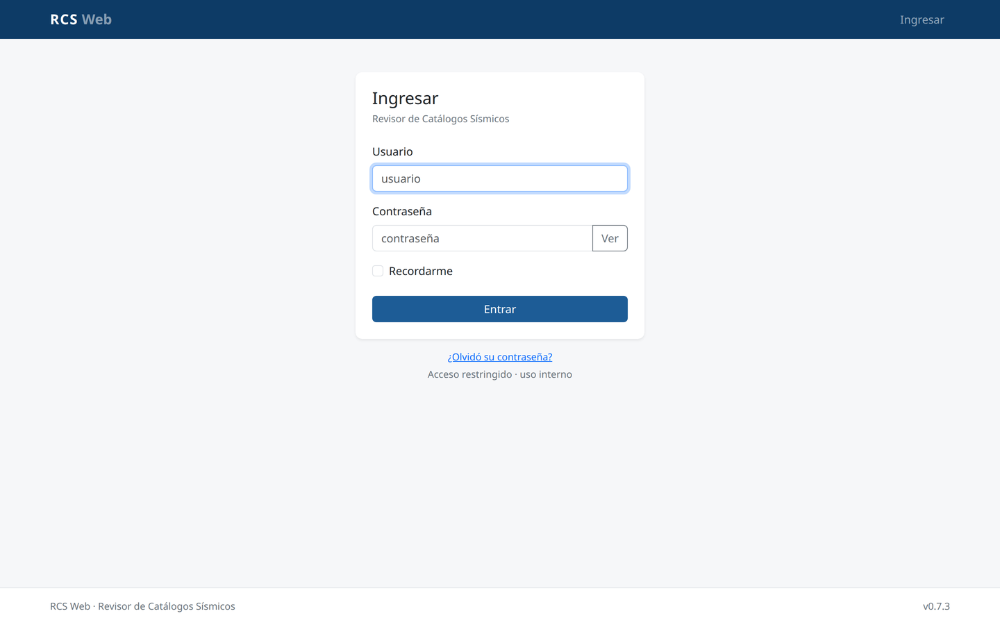

Si no recuerda la contraseña, use el enlace **«¿Olvidó su contraseña?»**. Por
seguridad, las claves no se recuperan: un administrador debe restablecerla
desde **Usuarios**. Si usted es el administrador, el manual técnico explica el
comando de recuperación.

### Roles

| Rol | Alcance |
|---|---|
| **Administrador** | Acceso total, usuarios y auditoría |
| **Supervisor** | Toda la operación y la auditoría, sin gestión de usuarios |
| **Analista** | Operación diaria sobre sus propios trabajos y solicitudes |
| **Consulta** | Solo lectura de sus propios trabajos |

El **analista** y la **consulta** solo ven los trabajos que crearon. El
administrador y el supervisor ven todos. La columna **Creador** del panel y la
línea «por …» del detalle identifican al autor.

Cada usuario tiene un **código corto de analista** y, opcionalmente, alias. El
código no tiene que coincidir con el nombre de usuario de la app. Por ejemplo,
el usuario `gjerez` puede tener código `Jere` y alias `JereV, jerez`.

En Resultados y Paneles, el analista solo ve los eventos cuyo campo de analista
coincide con su código o alias. La comparación ignora mayúsculas, acentos y
espacios, y tolera variantes por prefijo de al menos tres caracteres, como
`Jere` con `Jerez` o `JereV`. Si un nombre coincide con dos usuarios, no se
muestra y queda para revisión del administrador.

Sin código corto asignado, el analista o la consulta no ven eventos. El
administrador y el supervisor no se filtran por este código.

## Panel de trabajos

Al ingresar verá el resumen de trabajos y la lista de los más recientes.

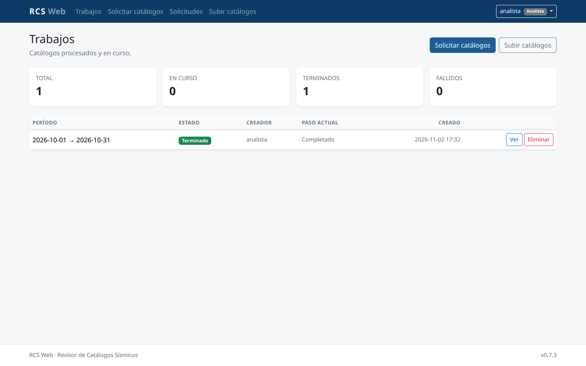

- **Total, En curso, Terminados y Fallidos** muestran los trabajos que puede
  ver.
- Cada fila indica período, estado, creador, paso actual y fecha de creación.
- **Ver** abre el detalle.
- **Eliminar** aparece solo si tiene permiso y el trabajo es suyo, salvo para
  administradores y supervisores.

## Crear un trabajo

Hay dos formas de iniciar un trabajo.

### Nuevo trabajo

Use el botón **Nuevo trabajo** de la página **Trabajos** para solicitar los
catálogos al servidor. Es la forma habitual: la descarga y la creación del
trabajo son automáticas.

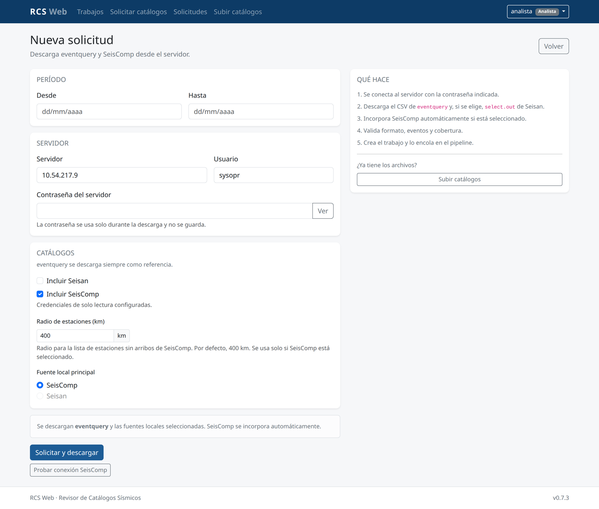

1. Indique el período, el servidor y las credenciales.
2. **Eventquery** se descarga siempre como referencia.
3. Los catálogos disponibles aparecen preseleccionados.
4. Puede cambiar los **nombres sugeridos** de cada fuente.
5. **Central** aparece como fuente directa, también preseleccionada. La tarjeta
   muestra el rango de fechas disponible en la base. Si el período queda fuera y
   hay otros catálogos, la solicitud se crea igual y Central no aporta eventos.
   Si Central es la única fuente local, el alta se rechaza para no crear un
   trabajo vacío. Si la base no está configurada, Central aparece sin seleccionar
   y se muestra el aviso de rango no disponible.
6. Elija la fuente principal.
7. Envíe **Solicitar y crear trabajo**.

Mientras se descargan los catálogos, el trabajo aparece en **Trabajos** como
**“Preparando catálogos”**. Si la descarga falla, aparece como **“Descarga
fallida”** y puede reintentarse desde el detalle. El detalle muestra el
progreso, el tiempo transcurrido y el avance de cada catálogo.

Si una descarga queda interrumpida, se marca automáticamente como fallida
después de 2 horas sin tarea activa. Un administrador o supervisor puede
**Eliminar solicitud** desde el detalle cuando no tiene un trabajo asociado.

### Advertencias de fuentes

Si una fuente no aporta datos, el detalle del trabajo muestra el bloque
**Advertencias de fuentes** con el motivo. Por ejemplo:

```text
Central: La base central no tiene eventos en el período seleccionado.
```

La validación se hace al crear el trabajo y, si faltaba, al abrirlo. El trabajo
puede continuar con las otras fuentes; la advertencia sirve para que el usuario
sepa que esa fuente no aportó al análisis.

La contraseña SSH se usa solo para la descarga y no se guarda. La fuente de
referencia se descarga siempre como catálogo de referencia; no es una fuente
local de Resultados.

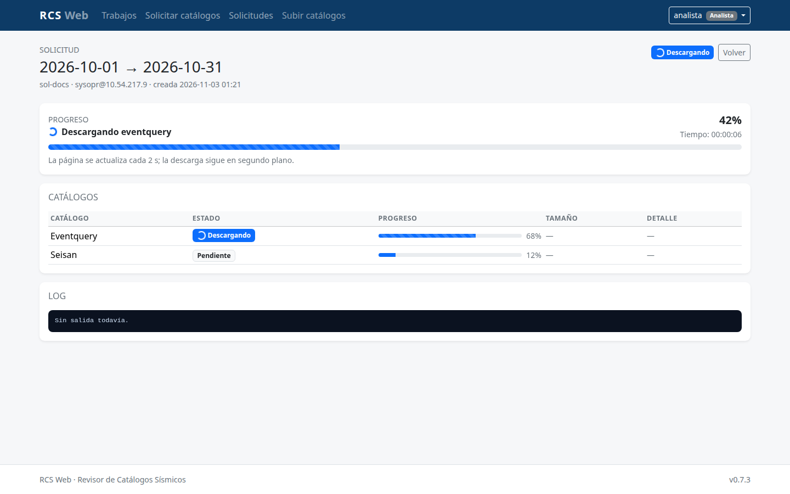

### Subir catálogos

Use **Subir catálogos** cuando ya tenga los archivos en su equipo. Se accede
desde el botón **Subir catálogos** de Nuevo trabajo.

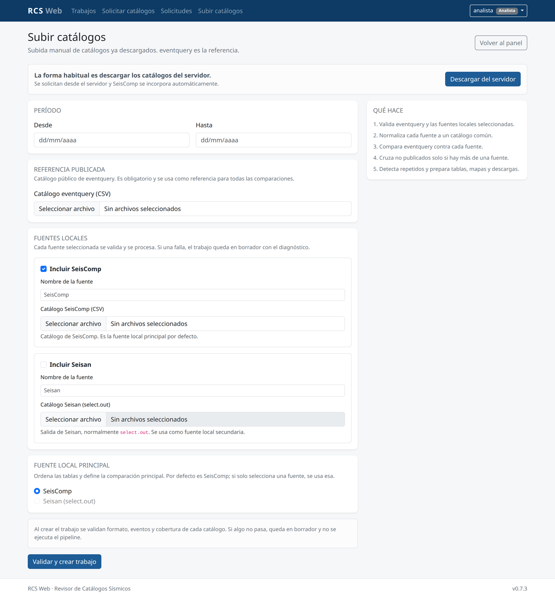

1. Seleccione el catálogo de referencia.
2. Agregue las fuentes locales disponibles según corresponda.
3. En cada fuente local puede cambiar **Nombre de la fuente** para
   identificarla mejor en tablas, paneles y filtros.
4. Si una fuente no requiere archivo, la tarjeta lo indica y muestra el nombre
   sugerido de la extracción. La consulta se hace directamente al crear el
   trabajo.
5. Si la fuente es **Central**, la tarjeta muestra el rango de fechas disponible
   en la base. Si el período queda fuera y hay otras fuentes, el trabajo se crea
   igual y Central no aporta eventos. Si Central es la única fuente local, el
   alta se rechaza para no crear un trabajo vacío.
6. Indique el período y la fuente principal.
7. Envíe **Validar y crear trabajo**.

Si falta un archivo, la conexión falla o el contenido no es válido, el trabajo
queda en **Borrador** con el detalle del problema. Corrija el archivo o el
período y cree uno nuevo, o elimine el borrador.

## Seguimiento del trabajo

El detalle muestra el progreso, los pasos, el registro y los accesos a los
resultados.

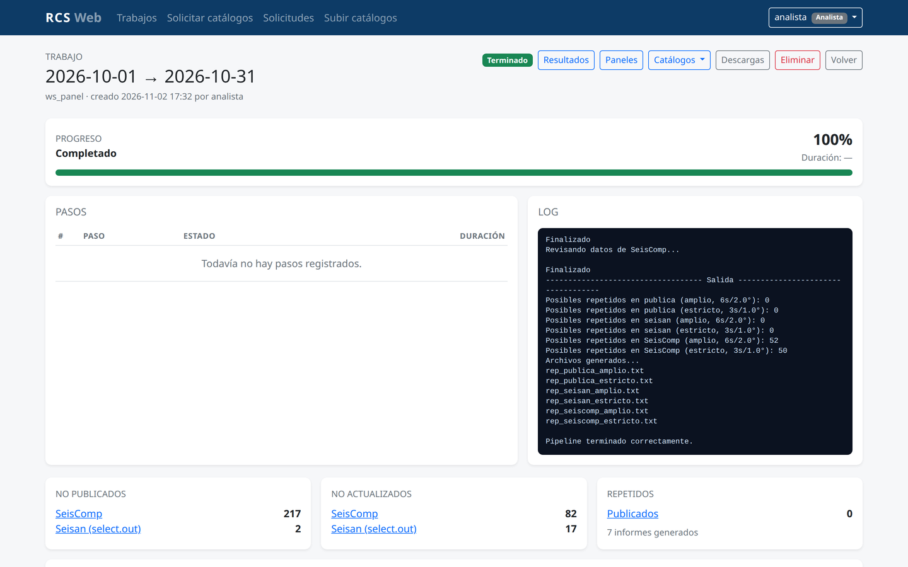

- **Resultados** lleva a las tablas del trabajo.
- **Paneles** abre el contexto sismotectónico.
- **Catálogos** permite revisar los catálogos procesados.
- **Descargas** reúne los archivos generados.
- **Cancelar trabajo** detiene un trabajo en cola o en ejecución.
- **Eliminar** borra el trabajo, sus archivos y sus resultados. La auditoría
  conserva el registro de la eliminación.
- Un paso que no aplica aparece como **Omitido** con el motivo; por ejemplo,
  `sin excluidos`.

## Resultados

Las tablas **No publicados**, **No actualizados** y **Repetidos** permiten
revisar los eventos.

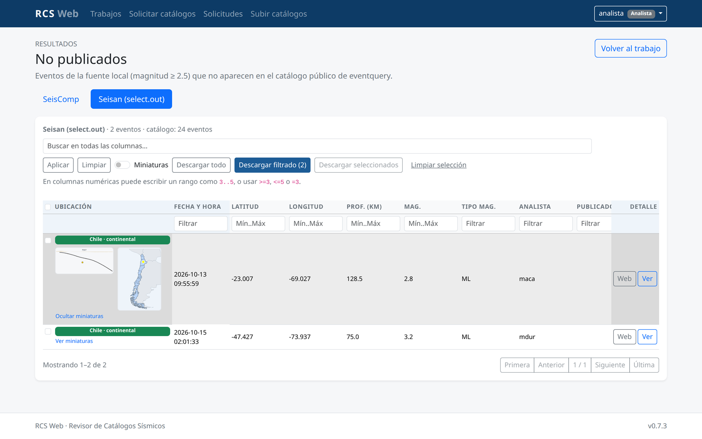

- **Buscar en todas las columnas** aplica una búsqueda general.
- **Filtros por columna**: las columnas de texto filtran por contenido. Las
  numéricas aceptan un rango como `3..5`, o expresiones como `>=3`, `<=5` y
  `=3`.
- **Ordenar**: haga clic en el encabezado de una columna.
- **Miniaturas**: active el interruptor o use **Ver miniaturas** en una fila
  para ver el perfil y el mini mapa de planta lado a lado.
- **Repetidos** busca duplicados dentro de cada catálogo, no entre fuentes. Si
  no hay ninguno, muestra «Sin repetidos en el período».
- **Ficha de ubicación**: indica Chile continental, insular, costa, mar
  chileno, otro país o alta mar.
- **Publicado en otra fuente**: cuando corresponde, indica la otra fuente donde
  se publicó el evento. **Tipo mag.** es el tipo de magnitud, no la fuente.
- **Descargar todo** incluye todas las filas del archivo.
- **Descargar filtrado** incluye todas las filas que cumplen el filtro, no solo
  la página visible.
- **Descargar seleccionados** incluye solo las filas marcadas, aunque estén
  ocultas por el filtro.
- La barra horizontal superior permite desplazar la tabla sin bajar hasta el
  final.

## Detalle del evento

Al pulsar **Ver** en una fila se abre la ficha del evento.

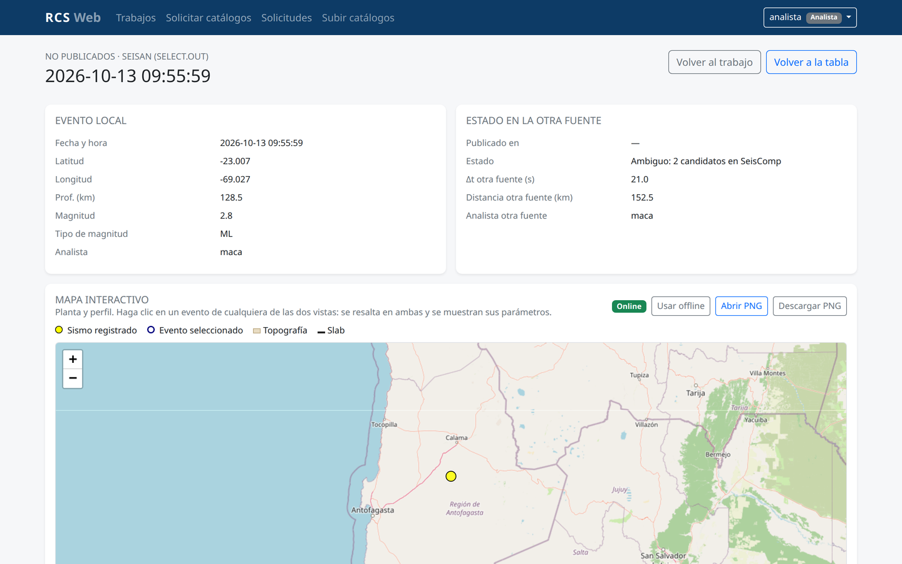

- La columna izquierda muestra los parámetros de la solución local.
- La columna derecha muestra el estado en la otra fuente, cuando existe.
- El mapa interactivo permite acercar, alejar y seleccionar eventos.
- La planta abre con una vista regional para que el evento se ubique en el
  contexto del país.
- La planta y el perfil ocupan la columna izquierda; al hacer clic en un evento,
  sus parámetros aparecen en el panel fijo de la derecha. En pantallas angostas
  el panel pasa debajo de los mapas.
- En modo offline se resaltan el contorno nacional y las divisiones regionales
  de Chile.

Más abajo está el perfil de subducción.

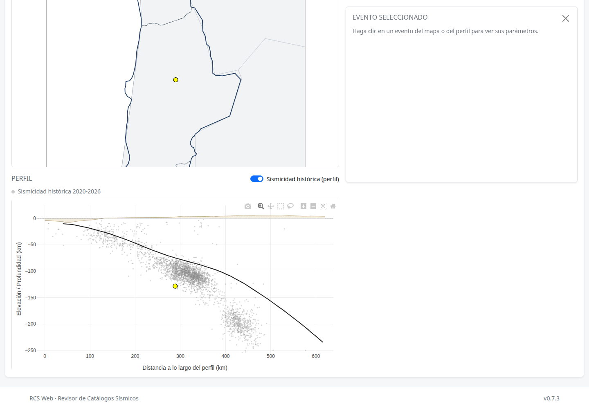

- **Sismicidad histórica (perfil)** agrega los sismos históricos en gris.
- El perfil conserva su escala al activar o desactivar la casilla.
- Al pasar el mouse por un evento, sus parámetros aparecen en el panel fijo y
  no se dibuja una etiqueta sobre los eventos vecinos. El clic fija la selección
  y resalta el evento en ambas vistas.
- El cursor del perfil se mantiene como puntero normal; el arrastre sigue
  permitiendo acercar una zona.
- En grupos con más de una solución, **Distancia** indica la separación respecto
  del evento de referencia. El punto de referencia se muestra como
  «0 km (referencia)». En **No actualizados** la referencia es la solución
  publicada (Eventquery); en **Repetidos** es la fila que abrió el detalle. En
  eventos únicos no se muestra la distancia, porque no hay otra solución con la
  cual comparar.
- En **No actualizados**, al seleccionar el evento publicado de Eventquery en
  la planta o en el perfil, el panel muestra **Analista probable** con todos los
  autores deducidos de las soluciones locales. El evento local conserva su
  **Analista** real.
- Si **Publicación probable** indica **No evaluable**, la ficha muestra el
  motivo, por ejemplo: **No evaluable: falta la atribución de otra fuente de
  datos**. Esto no invalida el evento: solo indica que no se pudo inferir la
  prioridad de revisión comparando las fuentes.
- **Abrir PNG** y **Descargar PNG** generan una imagen del mapa.
- El PNG incluye un encabezado con una fila por evento: fecha y hora, magnitud,
  profundidad, coordenadas, analista y estado en la otra fuente, separados por
  «|». En los no actualizados se muestran el local y el publicado, y debajo la
  diferencia.
- La vista en planta se adapta a la cantidad de soluciones:
  - con un solo evento usa una vista regional (unos 8° × 4°) para ubicarlo en
    el país;
  - con varias soluciones cercanas se acerca lo necesario para distinguirlas;
  - si el grupo está disperso, mantiene todos los eventos a la vista.

## Revisión de estaciones

En el detalle de un evento de una fuente local aparece la sección **Revisión de
estaciones**, con dos solapas:

- **Con arribos:** muestra los arribos de la solución agrupados por estación. El
  botón **Solo no utilizadas** deja a la vista únicamente los arribos que la
  solución no usó; **Quitar filtro** vuelve a la lista completa.
- **Sin arribos:** muestra las estaciones del inventario que quedaron dentro del
  radio de exportación y no tienen arribos en el evento. «Sin arribos» **no**
  significa «no grabó»: significa que la fuente no registra una llegada de esa
  estación para este evento.

Para saber si una estación **estaba grabando y no se usó**, la consulta de formas
de onda se inicia automáticamente al abrir la solapa **Sin arribos**. La
consulta revisa el archivo SDS y, si no encuentra datos, el tiempo real.

Mientras corre:

- la tabla sin verificar se muestra de inmediato;
- aparece el estado **Consulta en curso**;
- se puede seguir usando la página o cambiar de solapa;
- al terminar, la tabla se actualiza en el lugar y aparece el aviso
  **Disponibilidad actualizada**, sin recargar toda la página.

Si se cambia de evento o se recarga la página, la consulta continúa en segundo
plano. Al volver, se retoma el estado o se muestra directamente el resultado
guardado en caché.

El botón **Consultar formas de onda** permite iniciar la consulta manualmente.
Cuando ya hay resultados, cambia a **Volver a consultar formas de onda** para
actualizarlos.

Cuando se entra desde el listado de **Revisión de eventos**, los botones de
consulta y la consulta automática se ocultan: esa visita está enfocada en las
fases. La solapa **Sin arribos** y su tabla de disponibilidad siguen visibles.
Para consultar las ondas, entre al detalle desde **Catálogos** o desde la
revisión normal del evento.

Después de la consulta:

- **Formas de onda** indica **SDS**, **Tiempo real**, **Sin datos** o
  **No consultado**.
- **Evidencia** distingue **Verificado (SDS)**, **Verificado (tiempo real)**,
  **Indicio (actividad)**, **Sin evidencia** y **Sin consultar**.
- **Disp. no usada** queda en **Sí** cuando hay formas de onda.
- El filtro **Solo disponibles no usadas** deja únicamente las estaciones que
  estaban grabando y no se usaron en la solución.
- Las filas verificadas se resaltan en verde; las que solo tienen indicio por
  actividad, en ámbar.

La solapa **Sin arribos** solo aparece si la fuente declara esa capacidad. Cada
tabla se puede descargar como CSV y la descarga respeta el filtro activo.

La tabla usa encabezados cortos. El bloque **«Qué significa cada columna»**, que
aparece arriba de las tablas, explica los términos técnicos: **QC**, **SNR**,
**Resid.**, **Azimut**, **Dist.**, **Peso**, **Actividad ±2 h**, **Cobertura**,
**Evidencia** y **Disp. no usada**. El **Peso** se muestra en escala 0–4:
0 = mejor, 4 = no usada; el valor original de la fuente aparece al pasar el
cursor. Los valores de tipo de pick y control de calidad se muestran
traducidos: **Manual**, **Automático**, **Aprobado**, **Rechazado** y
**Sin evaluar**.

La columna **Streams** muestra el stream de referencia de la estación. Si hay
más de uno, el enlace **Ver todos** abre la lista completa en una ventana. El
CSV conserva la lista completa de streams, no solo el de referencia.

### Filtros de “Sin arribos”

Sobre la tabla hay tres controles:

- **Radio a mostrar (km):** recorta la lista ya exportada. Por defecto usa el
  radio con el que se generó el trabajo. Si se indica un radio mayor, al pulsar
  **Aplicar** se consulta el inventario de SeisComp y se abre una vista
  ampliada.
- **Resaltar cerca ≤ (km):** cambia los colores y las negritas. No recorta la
  lista. Por defecto son 50 km.
- **Solo cercanas:** deja únicamente las estaciones dentro del umbral de
  cercanía.
- **Sin límite:** consulta el inventario de SeisComp sin tope de distancia.

Los filtros locales se aplican en el momento. El botón **Aplicar** sirve como
respaldo si el navegador no ejecuta JavaScript. La línea de estado indica
cuántas estaciones se muestran y cuántas quedaron resaltadas. La descarga CSV
respeta los mismos filtros.

### Vista ampliada contra la base

Cuando el radio supera el exportado o se marca **Sin límite**, la aplicación
recalcula las estaciones contra el inventario vigente de SeisComp. Mientras
consulta muestra:

```text
Consultando la base de SeisComp…
```

Al terminar, la misma página muestra la **vista ampliada**, con un aviso y un
enlace **Volver a la lista exportada**. La tabla ampliada conserva los filtros,
los colores, la leyenda, las descargas y el botón **Consultar formas de onda**.

La ampliación consulta inventario y actividad; **no** comprueba formas de onda.
Para saber si una estación ampliada estaba grabando, use después **Consultar
formas de onda**.

Si el evento no trae la base de datos de origen, la ampliación no estará
disponible y habrá que reexportar la ventana con la versión actual.

### Límite de la consulta de formas de onda

Consultar las ondas de una lista ampliada puede tardar mucho. Por eso:

- por defecto se consultan las estaciones **visibles** y, si hay más de 150, las
  **150 más cercanas**;
- las estaciones que quedan fuera del límite permanecen como **No consultado**;
- si hay estaciones omitidas, aparece **Consultar todas (N)**;
- **Consultar todas** pide confirmación, se ejecuta por lotes en segundo plano y
  puede tardar varios minutos.

La línea de estado indica cuántas estaciones se están consultando. Al terminar,
si quedaron estaciones fuera del límite, se muestra un aviso.

Los límites se pueden ajustar en `.env`:

```dotenv
RCS_DISPONIBILIDAD_MAX_ESTACIONES=150
RCS_DISPONIBILIDAD_MAX_STREAMS=5000
```

### Estaciones en el mapa, propagación y tiempos de llegada

En el **detalle de un evento único**, cuando el canónico trae las coordenadas o
los tiempos necesarios, aparecen controles **justo arriba del mapa de planta**:

- **Estaciones en el mapa**
- **Propagación**
- **Tiempos de llegada**

No se dibuja nada al abrir el detalle: cada control trabaja solo cuando se
pulsa. Si faltan las coordenadas, no aparece el botón del mapa; si faltan los
tiempos, no aparece el de tiempos ni el de propagación.

Los controles también están disponibles al abrir un evento desde **Paneles**
con el botón **Ver**, porque esa acción abre el mismo detalle del evento. No
aparecen en los mapas de grupo con varios eventos.

#### Estaciones en el mapa

Agrega una capa de **triángulos** al mapa de planta:

- **triángulo relleno azul petróleo**: estación con pick observado;
- **triángulo hueco**: estación sin arribos.

Incluye todas las estaciones con arribos y hasta **20 estaciones sin arribos**,
las más cercanas. La opción **Mostrar todas** quita ese límite. El radio y
**Solo cercanas** se aplican a las estaciones sin arribos; los arribos se
muestran siempre. Cada triángulo abre un popup con estación, distancia, fase,
hora del pick, tiempo desde el origen, modo y uso en la solución. Cuando el
origen lo informa, el popup también muestra **Listado**, **Vigencia** y
**Procesado por**: de qué archivo o inventario salió la coordenada, si es una
lista actual o de la época del evento, y qué sistema procesó el origen.

Los estados de las formas de onda se muestran igual que en propagación:

```text
▲ observada · △ sin consultar · △× sin datos · △• disponible no usada
```

Y el resumen:

```text
En el mapa: 10 observadas · 0 sin consultar · 6 sin datos · 14 disponibles no usadas
```

#### Propagación

Muestra cómo avanzan los **frentes P y S** desde el epicentro hacia las
estaciones.

```text
▶ Reproducir   [✓] P   [✓] S   t = 24.3 s   [=====|======]   1x   Reiniciar
P 374 km · S 179 km
P alcanzadas: 27 · S alcanzadas: 27 · pendientes: 3
```

- **Frente P**, azul: avanza más rápido.
- **Frente S**, naranja: avanza más lento, detrás de la P.
- Cada frente tiene su anillo principal y anillos secundarios tenues.
- **Reproducir / Pausar** controla la animación.
- **1x / 2x / 5x** cambia la velocidad.
- El control de tiempo también se puede arrastrar manualmente.
- **Reiniciar** vuelve a t = 0.
- La reproducción completa dura unos **15 segundos a 1x**.
- Los interruptores **P** y **S** muestran u ocultan cada frente.
- El rótulo indica el radio actual de cada frente y si es observado o
  estimado.
- El resumen muestra cuántas estaciones alcanzó cada frente y cuántas siguen
  pendientes.

Cada estación se enciende en dos etapas:

- **anillo azul**: llegó la P;
- **anillo naranja**: llegó la S;
- **anillo sólido**: llegada observada;
- **anillo tenue**: llegada estimada.

Los tiempos P y S se calculan con el **primer pick de cada fase**. Si faltan
picks de una fase, se usa la envolvente de esa fase o la velocidad de respaldo:
`Vp = 6.0 km/s` y `Vs = 3.5 km/s`.

##### Listado comparativo de llegadas

Dentro de Propagación, el panel **Listado comparativo de llegadas** muestra las
estaciones que tienen al menos un pick, agrupadas por estación:

```text
AP01
  P   t teórico 26.2   t observado 32.5   Δ +6.3   Orden 2→3
  S   t teórico 44.9   t observado 44.9   Δ +0.0   Orden 2→2
```

- **t teórico:** tiempo de viaje calculado por el modelo, con la misma curva
  que usa el frente de propagación.
- **t observado:** el pick identificado por el analista.
- **Δ:** diferencia entre observado y teórico. Positivo = llegó tarde.
- **Orden:** posición teórica → posición observada dentro de la misma fase.
  `2→3` significa que debería haber sido la segunda y fue la tercera.
- P y S van en filas separadas. Si una estación tiene solo S, aparece solo con
  su fila S y no ocupa un lugar en el orden P.
- El orden de los grupos es por la primera llegada teórica de la estación; ese
  valor no se repite como texto para no recargar la lista.
- La tabla es compacta, sin scroll interno, para que se vea completa mientras
  avanza la reproducción.
- Durante la reproducción, el grupo y la fila que el frente va alcanzando se
  iluminan. Las filas futuras quedan tenues.
- `Δ` se marca en ámbar entre 2 y 5 s y en rojo sobre 5 s. `Orden` se resalta
  cuando la posición cambia.

##### Estado de las estaciones sin arribos

Tanto **Estaciones en el mapa** como **Propagación** distinguen tres estados
de disponibilidad de formas de onda:

| Estado | Marca | Significado |
|---|---|---|
| **Sin consultar** | sin marca | Todavía no se consultaron las formas de onda. La ausencia de arribo es una suposición. |
| **Sin datos (verificado)** | `×` | Se consultaron las ondas y no hay. La estación no estaba grabando o no hay datos. |
| **Disponible y no usada** | `•` | Hay formas de onda, pero la estación no tiene pick. Estaba operativa. |

- Los anillos **P** y **S** indican si cada frente ya la alcanzó.
- El triángulo conserva el estado de ondas.
- La marca `×` o `•` indica el estado de las ondas.
- En **sin datos** el borde es discontinuo; en **disponible** es más grueso.
- En **sin consultar** la estación se ve más tenue.
- El popup muestra:
  ```text
  Estado de ondas: Sin datos (verificado)
  ```
  o
  ```text
  Estado de ondas: Disponible y no usada
  ```
- La leyenda y el resumen están visibles cuando la capa está activa:
  ```text
  ▲ observada · △ sin consultar · △× sin datos · △• disponible no usada
  En el mapa: 10 observadas · 0 sin consultar · 6 sin datos · 14 disponibles no usadas
  ```

La consulta de formas de onda se realiza desde la solapa **Sin arribos**, con
los mismos filtros, límites y sondeo. No hay un botón de consulta en la barra de
propagación. Al terminar, se actualizan el panel, el mapa y el contador. Las
estaciones que queden fuera de la consulta permanecen como **sin consultar**.

Al iniciar la consulta, desde cualquiera de los dos botones, aparece un
**indicador fijo en la esquina inferior derecha** con un spinner y el tiempo
transcurrido:

```text
⟳ Consultando 44 de 44 estaciones… (12 s)
```

El indicador permanece visible aunque cambie de solapa o esté mirando el mapa,
y desaparece al terminar, al fallar o al quedar detenida la consulta.

La consulta de formas de onda **no entrega un tiempo de arribo**. Por eso la
estación sigue siendo **estimada** para la propagación; lo que cambia es la
certeza sobre si había datos y no se usó, o si no hay datos.

La propagación es una representación **geométrica y temporal**: no carga las
formas de onda reales. Las estaciones sin coordenadas no se dibujan, pero
pueden aparecer en la curva de tiempos si tienen distancia.

#### Perfil

Las mismas capas se aplican al mapa de perfil:

- **Estaciones en el mapa** y **Propagación** también dibujan sobre el perfil.
- Las estaciones se proyectan sobre la línea del perfil y se ubican en la
  superficie.
- Se muestran solo las que están a **≤150 km** de la línea y dentro del rango
  del perfil. El resto se omite con una nota breve:
  ```text
  Perfil: 27 de 30 estaciones a ≤150 km. Las lejanas no son representativas.
  ```
- Mantienen los triángulos, los badges `×`/`•` y los estados de ondas.
- La propagación dibuja un **frente proyectado** con el mismo radio y tiempo
  que el mapa de planta.
- Al activar o desactivar la sismicidad histórica, la capa se vuelve a aplicar
  automáticamente sobre el perfil redibujado.

#### Tiempos de llegada

Abre una gráfica de distancia contra tiempo desde el origen del evento:

- **picks observados**: triángulos azul petróleo;
- relleno si el pick es manual y hueco si es automático;
- **estaciones sin arribos**: triángulos huecos grises con su tiempo P
  estimado;
- **curvas P y S**: P en azul discontinuo y S en naranja punteado, con
  etiquetas directas **P** y **S**;
- **línea vertical**: marca el tiempo actual de la propagación.

Funciona aunque el evento no tenga estaciones sin arribos. Los campos **Vp** y
**Vs** permiten ajustar las curvas de referencia; **Actualizar** redibuja. Las
curvas son una **estimación** con velocidad constante, no un modelo de tierra
real.

### Colores de “Sin arribos”

| Condición | Significado |
|---|---|
| **Cerca y verificado con ondas** | Fondo verde y negrita: estaba grabando y no se usó. |
| **Cerca y con indicio por actividad** | Fondo ámbar y negrita: probablemente operaba, pero es una deducción. |
| **Cerca y sin evidencia** | Solo negrita: se consultaron las ondas y no hay, ni actividad. Posible caída. |
| **Lejos y verificado** | Texto verde, sin fondo. |
| **Lejos y con indicio** | Texto ámbar, sin fondo. |
| Lejos sin evidencia, o sin consultar | Sin resaltado. |

### Colores de “Con arribos”

| Condición | Estilo |
|---|---|
| Pick **manual usado** en la solución | Rojo y negrita. |
| Pick **manual no usado** | Ámbar. |
| Pick automático | Sin resaltado. |

El color indica la procedencia del pick, no su calidad.

Si la fuente declara la revisión pero el trabajo no trae los archivos
necesarios, la sección muestra **No evaluable** con un motivo genérico. Los
trabajos generados antes de esta versión también quedan como **No evaluable**,
porque no se reprocesan.

Si el servicio de formas de onda no está disponible en el entorno, el botón no
aparece y la revisión de estaciones sigue funcionando con el estado
**No consultado**.

## Revisión de eventos

Después del procesamiento, la app reúne dos señales:

- **Solución sospechosa:** la localización no calza con el contexto
  sismotectónico.
- **Fases inconsistentes:** las lecturas de fase no respetan el orden
  distancia-tiempo.

La revisión es posterior a la publicación. La tarjeta **Revisión de eventos** de
la página del trabajo abre el listado. Hay tres alcances:

- **Revisión prioritaria:** eventos publicados con solución sospechosa, tengan o
  no fases inconsistentes. Es la vista más crítica y la que se abre por defecto.
- **Publicados:** todos los eventos publicados, con solución sospechosa o con
  fases inconsistentes.
- **Todos:** agrega los eventos no publicados que tienen fases inconsistentes,
  para revisar la calidad del catálogo. Los sospechosos no publicados sin fase
  quedan en los paneles.

Cada evento muestra un **motivo**:

| Motivo | Significado |
|---|---|
| `Fase inconsistente` | Tiene anomalía de fases y la solución es normal |
| `Solución sospechosa` | La localización es sospechosa y no hay anomalía de fases |
| `Fase y solución` | Tiene las dos señales |

Cada evento muestra también el **patrón** de las fases y la **cobertura**:

| Patrón | Lectura posible |
|---|---|
| `puntual` | Una o pocas estaciones con residual extremo; asociación o pick erróneo |
| `sistemático` | Muchas estaciones con residuales del mismo signo; modelo, profundidad u origen |
| `fuera_de_orden` | Una fase no respeta el orden esperado por distancia: la estación más cercana tiene mayor residual que una más lejana |
| `fuera_de_orden_debil` | La estación más cercana llega después, pero su fase influyó poco en la solución (peso 3) |
| `mixto` | Varias señales a la vez |
| `pick_antes_origen` | El pick es anterior al origen |

Una **fase inconsistente con la distancia** solo indica que su tiempo o
residual no corresponde al orden esperado por distancia. Se evalúa por separado
para P y para S.

La **fuerza** de las fases es `fuerte` o `débil`. Un residual alto en una fase
con peso 0–2 genera una anomalía fuerte; en una fase con peso 3 genera una
anomalía débil. Una anomalía débil se muestra igual, con la etiqueta **indicio
débil**, para que el usuario decida si pide revisión.

El **peso** se muestra en la escala 0–4 que usan los analistas: 0 = mayor
influencia, 4 = sin influencia. Solo las fases con peso 0–3 entran al análisis;
las de peso 4 no aportaron a la solución y no generan indicios. El valor
original de la fuente aparece al pasar el cursor sobre el peso. El listado de
indicios no muestra peso; solo el detalle.

Los números se muestran con pocos decimales: residual 2, distancia y tiempo 1,
azimut 1, magnitud y profundidad 1, conteos enteros. Un valor distinto de cero
que redondea a cero se muestra como `<0,01` o `<0,1`.

La columna **Prioridad** combina publicación, solución y fuerza de las fases:

| Prioridad | Combinación |
|---|---|
| Alta | publicado + solución sospechosa + fase fuerte |
| Media | publicado + solución sospechosa (fase débil o sin fase) |
| Baja | publicado + solución normal + fase fuerte; o no publicado + sospechoso + fase fuerte |
| Informativa | resto de las combinaciones |
| Sin evaluar | no se pudo determinar si está publicado |

La **Revisión prioritaria** incluye Alta y Media: exige un evento publicado con
solución sospechosa. Una fase fuerte con solución normal queda en **Baja** y no
entra a la vista prioritaria: se revisa como calidad de catálogo. La columna
**Solución** es la que decide la prioridad; ya no es solo un criterio de orden.

El listado principal y la tabla de evidencia se ordenan haciendo clic en
cualquier encabezado. El segundo clic invierte el orden. No se recarga la
página. El orden inicial es prioridad, solución, mayor residual y fecha.

La **cobertura** es `fuerte` o `débil` y describe la geometría de las
estaciones, no el contexto sismotectónico:

- **Fuerte:** al menos 5 estaciones disponibles y usadas (8 usadas si no hay
  inventario), azimutal gap ≤ 180° y perfil asignado.
- **Débil:** falla alguna de esas condiciones.

Un residual alto en una zona con pocas estaciones o con un azimutal gap grande
puede deberse al modelo o a la cobertura, no solo a la asociación. La app
entrega la evidencia y el patrón; no sentencia la causa. La cobertura no cambia
la prioridad: es una advertencia sobre cuán concluyente es la evidencia.

El nombre del evento en el listado abre el detalle del catálogo en la sección
de revisión. No hay un botón **Mapa** separado: el detalle del catálogo es el
único destino y ahí están la evidencia, las estaciones, el mapa y los tiempos.

La sección **Revisión del evento** del detalle muestra patrón, cobertura,
publicación y solución, sin badges de estado. Debajo aparece la **evidencia
principal**, es decir, el arribo con mayor residual:

```text
Evidencia principal: C1 AP01 P — residual +7.27 s · peso 1
```

La tabla completa queda plegada en **Ver evidencia del indicio**: estación,
fase, pick, `t (s)`, residual, peso, distancia y tipo de indicio. Si el evento
no tiene anomalía de fases, la sección muestra **Sin inconsistencia de fases** y
la explicación de la solución, por ejemplo el residuo al slab.

En el listado, un evento publicado con solución sospechosa se marca como
**Revisión prioritaria**. Un evento no publicado se muestra igual, como calidad
de catálogo.

El listado incluye una columna **Solución** con la clasificación de localización
que ya calculan los paneles y el detalle del catálogo. Es una dimensión distinta
de las fases: `Sospechosa`, `Normal` o `No evaluable`. El listado reutiliza esa
clasificación en lugar de recalcularla.

El mapa, el perfil y los controles de **Tiempos de llegada** están en la sección
siguiente del mismo detalle. La sección de indicios ya no tiene botones propios:
la navegación queda en el mapa. El **Listado comparativo de llegadas** aparece
debajo del mapa y solo cuando **Propagación** está activa. Los analistas pueden
abrir el detalle del catálogo de sus propios eventos para usar estas vistas.

Los analistas ven los eventos de revisión de sus propios trabajos.
Administradores y supervisores ven todos y pueden **pedir revisión**; la
solicitud queda registrada con usuario, fecha y nota. La app es de revisión
posterior: no alerta antes de publicar ni modifica la solución.

Si el análisis usa residuales completados temporalmente desde otra fuente local,
aparece un aviso. Esos residuales no provienen de la base de la fuente
analizada; se usan solo para poder evaluar las fases en este trabajo.

## Paneles sismotectónicos

Los paneles agrupan los eventos por perfil de subducción y, cuando no tienen
perfil, por territorio.

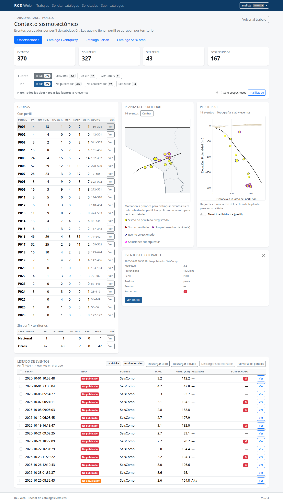

- **Fuente** y **Tipo** filtran los grupos, la planta, el perfil y el listado.
  Una pestaña con cero eventos se puede abrir y muestra el aviso
  correspondiente.
- **Grupos**: seleccione un perfil o territorio. Las flechas **↑/↓** recorren
  la lista.
- **Ver** abre el detalle del grupo con el mismo mapa interactivo de Resultados
  y Catálogos: planta, perfil, selector online/offline, listado de eventos y
  botones para abrir o descargar el PNG.
- Al volver desde el detalle, se conserva seleccionado el mismo perfil o
  territorio que estaba viendo.
- Al pasar el cursor por un evento de la planta o del perfil, el detalle se
  previsualiza en el cuadro ubicado justo debajo de ambos mini mapas. Al hacer
  clic, la selección queda fija. El cuadro no tapa la interfaz ni los eventos
  vecinos.
- **Planta del grupo**: muestra los eventos y las divisiones regionales de
  Chile. Use **Centrar** para volver al encuadre del grupo después de hacer
  zoom o desplazar.
- **Perfil**: topografía, slab y eventos. La casilla de sismicidad histórica
  carga la serie del perfil seleccionado.
- **Solo sospechosos** limita la vista a los eventos marcados.
- **Ir al listado** lleva a la tabla de eventos del grupo.
- **Descargar** permite bajar todo, lo filtrado o lo seleccionado.
- **PNG del grupo**: identifica el perfil o territorio, la fuente y los filtros
  aplicados, y muestra los conteos de No publicados, No actualizados y
  Repetidos. No incluye el listado de eventos dentro de la imagen.

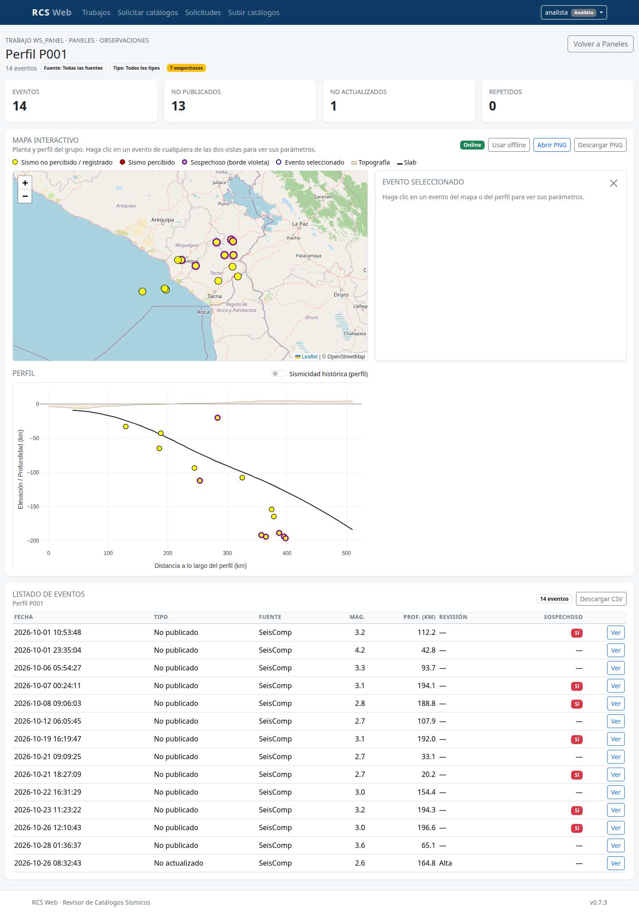

## Catálogos

Desde el detalle del trabajo puede abrir los catálogos procesados. Los nombres
visibles provienen del manifiesto de fuentes y pueden cambiar sin modificar la
aplicación.

- Las columnas y filtros funcionan como en los resultados.
- Cuando la fuente es **Central**, el catálogo agrega **Publicado** (`Sí`/`No`)
  y **Revisión** (`Revisado`, `Final`, `Confirmado`, etc.). Así se distingue un
  evento local de uno que no está publicado, sin ocultar los publicados.
- **Administrador y supervisor** mantienen el acceso completo: columnas de
  analista, **Web**, **Ver**, **Ver miniaturas**, descargas completas y el nuevo
  **Descargar catálogo**.
- **Analista y consulta** ven todas las fuentes y usan los filtros, pero no ven
  las columnas **Analista** ni **Analista probable**, y no pueden abrir **Web**,
  **Ver** ni **Ver miniaturas**. Tampoco pueden usar las descargas completas.
  Su única descarga es **Descargar catálogo**.
- **Descargar catálogo** abre una vista previa con mapas de planta por
  territorio y dos variantes por perfil. **Ningún mapa se genera al abrir la
  página**: use **Ver** para abrirlo en un modal con indicador de actividad, o
  **Descargar** para obtener solo ese PNG. El panel **Generar todos los mapas**
  permite incluir o no las plantas y elegir las variantes de perfil antes de
  descargar el ZIP. La interfaz indica cuántos PNG se incluirán y ofrece
  **Seleccionar todo**, que marca las plantas y las dos variantes de perfil.
  Permite obtener:
  - `catalogo.csv`, con fecha y hora, latitud, longitud, profundidad, magnitud,
    tipo de magnitud y referencia geográfica si la fuente la tiene;
  - `planta_nacional.png`, `planta_insular.png`, `planta_antartico.png` y
    `planta_otros.png`, cada uno solo si tiene eventos;
  - `perfil_<id>.png` (solo perfil) y `perfil_<id>_planta.png` (perfil + planta)
    por cada perfil, agrupados en **Ver** y **Descargar** con las dos variantes
    **Planta/perfil** y **Perfil**;
  - un ZIP con todo lo seleccionado.
  El CSV no incluye el nombre del analista. Los mapas de esta vista llevan una
  leyenda mínima: amarillo para no percibidos y rojo solo si hay percibidos.
  En el mapa de solo perfil, la leyenda queda debajo del gráfico para no tapar
  los eventos.
  Los eventos percibidos se dibujan sobre los no percibidos. El encabezado del
  PNG muestra los filtros aplicados, incluida la búsqueda de texto.
- La planta se separa en **Chile continental**, **territorio insular**,
  **territorio antártico** y **Otros**. Los eventos fuera de Chile pasan a
  Otros cuando superan el radio de influencia según la magnitud: 200 km para
  M<4, 300 km para M4, 400 km para M5 y 500 km para M6 o más. El mapa de Otros
  incluye la costa o islas chilenas más cercanas para orientar la vista y
  muestra solo el nombre y el punto de la localidad más cercana a los sismos.
- Cada perfil se asigna por cercanía individual del evento. Los eventos sin
  perfil aparecen solo en las plantas. Si el catálogo no tiene perfiles, solo
  se generan las plantas.
- **Eventquery** incluye **Percibido** y **Analista probable**, calculado
  cruzando la solución publicada con las fuentes locales del manifiesto. Si más de una fuente
  aporta una solución, se muestran todos los autores, por ejemplo
  `SeisComp: cris; Seisan: beto`. El dato es una deducción, no un campo del
  catálogo original de Eventquery.

## Usuarios y perfil

Cada usuario puede cambiar su contraseña desde **Mi perfil**.

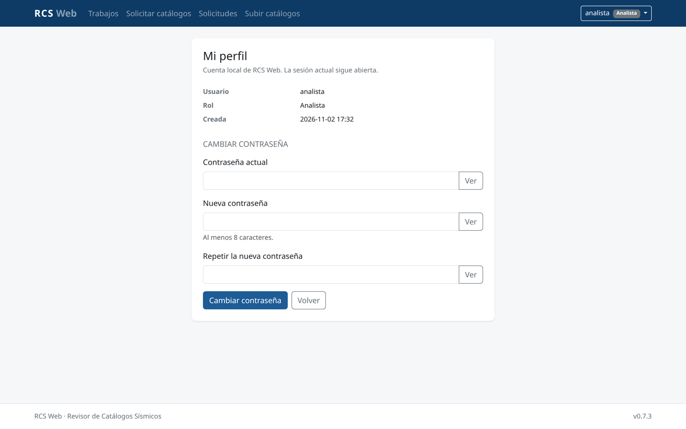

El **administrador** además dispone de la pantalla **Usuarios**.

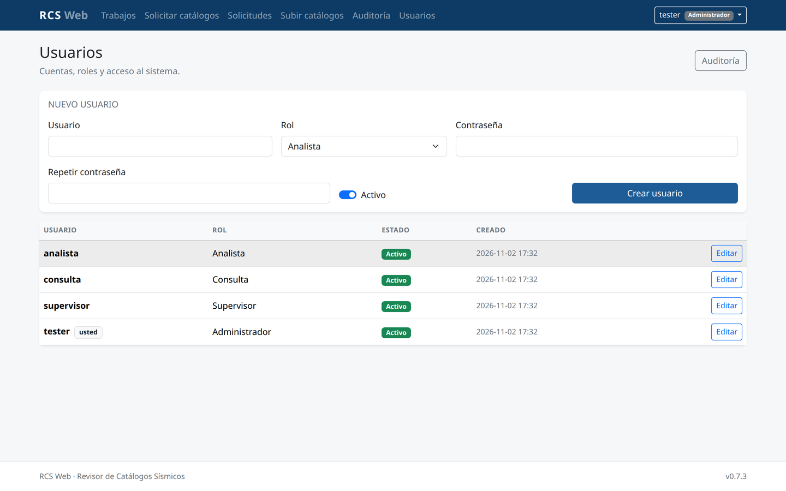

- Crear usuarios.
- Cambiar el rol.
- Activar o desactivar cuentas.
- Restablecer contraseñas.

El sistema no permite dejar sin administradores activos. Si una cuenta se
desactiva, su sesión se cierra en la siguiente petición.

## Preguntas frecuentes

**No veo un trabajo que otro usuario creó.**
Es normal: los analistas y las consultas solo ven sus propios trabajos. El
administrador o el supervisor pueden verlo.

**No aparece la fuente Eventquery.**
Puede tener cero eventos. La pestaña se puede abrir y muestra el aviso de
filtro sin eventos.

**El mapa se ve demasiado cerca.**
La planta usa una vista regional; puede alejar con la rueda del mouse. En los
paneles, use **Centrar** para volver al encuadre del grupo.

**La página tarda y no sé si está trabajando.**
Después de una navegación lenta aparece un aviso con un spinner y
«Cargando…».

**Olvidé mi contraseña.**
Use **«¿Olvidó su contraseña?»** en el ingreso. La clave solo puede
restablecerse desde **Usuarios** por un administrador.

**¿Dónde quedan mis trabajos?**
Los metadatos y la lista quedan en la base de datos de la aplicación; los
archivos de cada trabajo se guardan en el espacio de trabajo del servidor. El
manual técnico detalla las rutas.

**¿Puedo descargar los resultados?**
Sí, si su rol lo permite. Analistas, supervisores y administradores pueden
exportar; la consulta es solo lectura.
